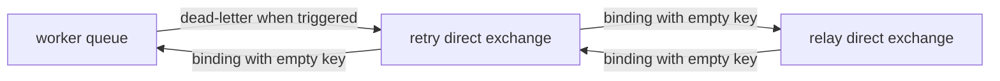

# Effective dead-letter exchange coverage

A dead-letter exchange (DLX) is an ordinary exchange used to republish a
queue's messages after events such as rejection or expiration. In the
[retry graph](topology-graph-construction.md#a-small-runnable-example),
the queue `worker` dead-letters to `retry`. That hop starts a new publication.
The key on that publication determines which bindings at `retry` match.



## Try the retry graph

Run the [graph-construction example](topology-graph-construction.md#a-small-runnable-example)
first. This continuation copies its `capture` for each case and changes only
the dead-letter routing-key override on `worker`, the only queue. Predict
which publications can return to `worker` before running it.

```python
from copy import deepcopy

from rabbitmq_management_sdk import ClusterAuditor
from rabbitmq_management_sdk.resources.v4.admin.schemas.export_response import ClusterDefinitionsResponse

for override in (None, "orders.created", ""):
    variant = deepcopy(capture)
    if override is not None:
        variant["queues"][0]["arguments"]["x-dead-letter-routing-key"] = override
    variant_auditor = ClusterAuditor(ClusterDefinitionsResponse.model_validate(variant))
    (result,) = variant_auditor.dead_letter_coverage()
    print(repr(override), result.status.value, [queue.name for queue in result.destinations])
```

```text
None undetermined []
'orders.created' no_destination []
'' destination_possible ['worker']
```

Without an override, RabbitMQ uses the message's original routing key, which
the audit does not have. The audit evaluates the republished message at
`retry` without inferring its key from the earlier `events` bindings.
`orders.created` matches neither binding at `retry`, while the explicit empty
key matches both and can reach `worker`.

The configured arrows give two structural cycles and one message-loop
candidate in all three cases. The coverage result answers the separate
question of where the republished message can route once dead-lettering occurs.
Follow the [exchange worklist trace](exchange-routing-coverage.md#trace-one-publication)
to see how the walk through `relay` terminates.

## Result contract

Call `ClusterAuditor.dead_letter_coverage()` for an immutable tuple of
`DeadLetterCoverage` values, ordered by complete source queue identity. The
same tuple is available as `TopologyAuditReport.dead_letter_coverage`.

| Status | Captured fact |
| --- | --- |
| `no_dlx` | No effective DLX is configured for this classic or quorum queue. |
| `missing_exchange` | A DLX is configured, but its exchange is absent from the captured graph. |
| `no_destination` | The supported routing analysis establishes no contained queue destination. |
| `destination_possible` | At least one contained queue destination is established from known routing decisions. |
| `undetermined` | Required information or semantics are unresolved, so no destination can be established or ruled out. |
| `not_applicable` | The source is a stream, which does not support dead-lettering. |

These are facts, not severity levels. Terminal parking queues and queues
intended to discard rejected messages remain in the results. Apply naming
conventions, allowlists, or application policy in the consumer of the SDK.
The SDK does not infer terminal intent from names such as `parking` or `plq`.

Each result retains `queue` (the source `QueueNode`),
`dead_letter_exchange` (the effective exchange `NodeId`, or `None` when no
single value is established), `routing_key` (the configured override),
`destinations` (distinct declared queue identities), and `issues` (distinct
`DeadLetterRoutingIssue(resource, reason)` values). Destinations are ordered
by identity; issues are ordered by resource identity and reason.

When the capture establishes that no override is configured, the result's
`routing_key` is `None` and the audit has no original message key to evaluate.
With missing evidence, `None` can also mean the effective override is
unavailable. An empty string is an explicit override.

One established destination is sufficient for `destination_possible`. Other
branches can remain unresolved, so inspect `issues` when completeness matters.
Issues can accompany `no_destination` when an unknown selector leads only to
known dead ends.

## Run against the saved demo

Run from the repository root with its complete RabbitMQ 4.3 definitions and
paired runtime observations. The observations supply selected-policy evidence:

```python
from collections import Counter
from pathlib import Path

from rabbitmq_management_sdk import ClusterAuditor
from rabbitmq_management_sdk.topology import DeadLetterCoverageStatus

capture = Path("tests/integration/rmq-4.3/complex-topology")
auditor = ClusterAuditor.from_files(
    capture / "full-export-definitions.json",
    queues_path=capture / "queues.json",
    exchanges_path=capture / "exchanges.json",
)
results = auditor.dead_letter_coverage()
counts = Counter(result.status for result in results)
for status in DeadLetterCoverageStatus:
    print(status.value, counts[status])

for result in results:
    if result.status == DeadLetterCoverageStatus.MISSING_EXCHANGE:
        assert result.dead_letter_exchange is not None
        print(result.queue.id.vhost, result.queue.id.name, result.dead_letter_exchange.name)
```

Expected output:

```text
no_dlx 34
missing_exchange 1
no_destination 0
destination_possible 10
undetermined 0
not_applicable 1
topology-demo.diagnostics diag.missing-dlx missing.dlx
```

The `no_dlx` count includes terminal queues. The saved DLX paths are
resolvable; focused tests separately create routing mismatches and unknown
message cases. Ordinary tests never rewrite these captures.

For live capture prerequisites, see the
[auditing quick start](topology-auditing.md#quick-start-run-a-bounded-audit).
Coverage performs no HTTP calls and also works through `from_topology()`.

## Routing and uncertainty

The parser resolves direct queue arguments over the broker-selected regular
policy, independently for the DLX and routing-key settings. When the export
omits the entire queue argument map, a matching classic or quorum queue
observation can supply it. The audit uses the resulting `DEAD_LETTER` edges.
If a captured policy could supply an unresolved routing setting and
construction needs an unavailable broker selection to resolve it,
`ClusterAuditor` raises `TopologyParseError`. For example, a definitions-only
capture might contain a relevant DLX policy and a queue with no direct DLX
argument. See
[RabbitMQ DLX configuration](https://www.rabbitmq.com/docs/4.2/dlx#how-dead-lettering-is-configured).

When construction can proceed and still cannot establish a classic or quorum
queue's DLX route, coverage returns `undetermined` with
`dlx_route_not_captured`. For example, the capture may omit the queue argument
map with no matching observation, or omit the policy section when policy
evidence would be needed to rule out a DLX. For a quorum queue with no graph
edge, coverage also checks its delivery configuration for DLX evidence. The
result retains any captured exchange name, including the empty name of the
default exchange, and leaves the routing key unavailable. The queue limits
audit includes the same coverage result.

Routing follows exchange bindings and conditional alternate exchanges within
the same cluster and vhost:

| Exchange | Evaluation |
| --- | --- |
| Direct | Exact equality against a known dead-letter routing key. |
| Topic | Dot-separated words: `*` matches one, `#` matches zero or more. A binding consisting solely of `#` words accepts any original routing key. |
| Fanout | Every binding matches, independently of routing keys. |
| Headers | Nonempty header predicates are unknown. Empty predicates match for `all`/`all-with-x` and do not match for `any`/`any-with-x`. Ordinary modes ignore `x-*` arguments. |
| Default exchange as DLX (`""`) | A known key names a queue directly; implicit bindings need not appear in definitions. |
| Other types or unsupported contexts | Explicit `unsupported_routing_semantics` uncertainty. |

See RabbitMQ's [exchange guide](https://www.rabbitmq.com/docs/4.2/exchanges)
and [headers implementation](https://github.com/rabbitmq/rabbitmq-server/blob/v4.3.6/deps/rabbit/src/rabbit_exchange_type_headers.erl).
Streams have a distinct [feature set](https://www.rabbitmq.com/docs/4.2/streams#feature-matrix):
stream sources are `not_applicable`, but a stream can be a destination.
Unknown plugin queue types are `undetermined`.

An alternate exchange is considered only when that exchange has no matching
binding destination. A matching exchange-to-exchange binding suppresses the
parent fallback even if the later exchange has no queue destination. The
live tests reproduce this on RabbitMQ 4.2 and 4.3; see the
[routing implementation](https://github.com/rabbitmq/rabbitmq-server/blob/v4.3.6/deps/rabbit/src/rabbit_exchange.erl).
Unknown binding matches make alternate activation conditional.

If a reachable exchange could have a policy-defined alternate, a missing
policy selection adds a `policy_selection_not_captured` issue when no
immediate binding is known to match. An uncaptured exchange argument map can
leave a direct alternate unresolved under the same condition, with the issue
`exchange_arguments_not_captured`. Coverage is `undetermined` if the missing
evidence leaves destination existence unresolved. The
[exchange routing guide](exchange-routing-coverage.md#routing-rules-and-limits)
explains how argument maps and policy selections affect the evidence.

Issue reasons identify unknown original keys, required message headers,
unsupported semantics, missing downstream resources, incomplete binding
evidence, unsupported queue types, uncaptured alternate-policy selections, and
conflicting manual routes. A default exchange encountered as a nested routing
target is conservatively unsupported. Exchange cycles terminate without
enumerating paths, and repeated DLX/key pairs share evaluation within one call.

This conservative analysis does not jointly solve combinations of unknown
keys or headers across branches. Some configurations remain `undetermined`
when a message-specific analysis could establish a destination. Malformed
headers-binding JSON or a keyed binding without its captured key is likewise
undetermined when it could affect destination existence.

## Scope and tests

Traversal stops at queues. Later dead-lettering, shovel consume-and-publish
steps, federation transfers, and consumer retries are separate operations.
Possible routing does not establish a dead-letter event or queue acceptance.
Broker health, permissions, queue limits, delivery strategy, and message death
history are outside the result. RabbitMQ can also suppress certain
[dead-letter cycles](https://www.rabbitmq.com/docs/4.2/dlx#dead-letter-cycle).

The caller owns capture completeness and consistency. Missing resources are
absent from the supplied graph, not proven permanently absent on the broker.
Read dangling-edge and cycle findings alongside coverage.
The [queue limits audit](queue-limits.md) links each row to this coverage for
reading the configured thresholds and possible DLX destinations together.

Queue-specific analysis is in the internal `topology/dead_letter.py`, which
delegates exchange traversal to the shared `topology/routing.py` engine.
[Exchange coverage](exchange-routing-coverage.md) uses that same engine.
Import DLX result and uncertainty types from `rabbitmq_management_sdk.topology`
and use the auditor facade.
Coverage lives in:

- `tests/unit/test_models.py` for public result invariants;
- `tests/unit/test_dead_letter.py` for routing and uncertainty;
- `tests/integration/test_dead_letter_captures.py` for captured selected policies;
- `tests/shared/complex_topology.py` for shared captured/live demo expectations;
- facade and process-transfer tests for graph-only analysis; and
- `tests/live/test_dead_letter_coverage.py` for broker routing and actual
  dead-letter delivery on disposable RabbitMQ 4.2 and 4.3 brokers.
