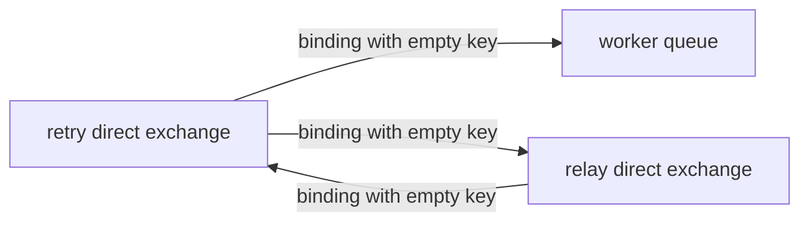
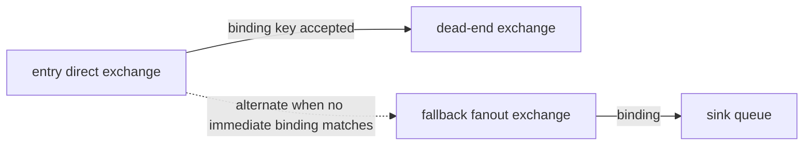

# Routing-aware exchange coverage

In the [retry graph](topology-graph-construction.md#a-small-runnable-example),
the `retry` exchange has two outgoing bindings. A direct exchange follows a
binding only when the publication's routing key matches the binding key
exactly. What happens when the key is `orders.created`, or when it is empty?



## Try the retry graph

Run the [graph-construction example](topology-graph-construction.md#a-small-runnable-example)
first. This continuation uses its `auditor` to compare publications to `events`
and `retry`.

```python
for exchange, key in (
    ("events", "orders.created"),
    ("retry", "orders.created"),
    ("retry", None),
    ("retry", ""),
):
    result = next(
        result
        for result in auditor.exchange_routing_coverage(routing_key=key)
        if result.exchange.id.name == exchange
    )
    print(exchange, repr(key), result.status.value, [queue.name for queue in result.destinations])
```

```text
events 'orders.created' destination_possible ['worker']
retry 'orders.created' no_destination []
retry None undetermined []
retry '' destination_possible ['worker']
```

Both exchanges have outgoing edges. Counting those edges answers how many
hops are configured. Evaluating the key answers which queues one publication
can reach. The same `orders.created` key matches a binding at `events` and
matches neither binding at `retry`.

## Trace one publication

For a publication to `retry` with the empty key, the analysis starts a worklist
with `retry`. A worklist is a queue of graph nodes still to examine. The router
takes each node from the front and appends the destinations it can follow.

| Node taken from the worklist | Action | Worklist after the action |
| --- | --- | --- |
| `retry` | Both bindings match. Add `relay` and `worker`. | `relay`, `worker` |
| `relay` | Its binding back to `retry` matches. | `worker`, `retry` |
| `worker` | Record a destination. A queue ends this routing operation. | `retry` |
| `retry` | Its established route has already been processed. | Empty |

In the implementation, each work item pairs a node with an `established`
flag. A binding that depends on an unknown key can reach a node conditionally.
That visit leaves room to process the same node again if another branch
establishes a route to it. Skipping a repeated pair lets the walk finish even
when exchanges form cycles. For a fresh routing operation after `worker`
dead-letters a message, see [dead-letter coverage](dead-letter-coverage.md#try-the-retry-graph).

## Degree and contextual routing analysis

`ClusterAuditor.black_hole_exchanges()` retains its existing contract: return
non-default exchanges with no captured outgoing edges. It does not evaluate
keys or follow exchange chains.

`ClusterAuditor.exchange_routing_coverage(routing_key=...)` returns a result
for every contained exchange, including default and internal exchanges. It
follows bindings and conditional alternate exchanges toward declared queues.
Each result retains the exchange, the supplied key, destinations, and issues.

| `RoutingStatus` | Meaning for the supplied context |
| --- | --- |
| `NO_DESTINATION` (`no_destination`) | The analysis establishes no contained queue destination. |
| `DESTINATION_POSSIBLE` (`destination_possible`) | At least one contained queue destination is established through known routing decisions. |
| `UNDETERMINED` (`undetermined`) | Required evidence or semantics are unresolved, preventing a conclusion about destination existence. |

A `no_destination` result for a supplied key does not mean the exchange
cannot route other publications. For example, a direct exchange bound to key
`accepted` can route that key while rejecting `other`.

With `routing_key=None`, key-dependent decisions remain unresolved. The
analysis does not invent a key from bindings or incoming publications, nor
solve whether some combination of unknown selectors can match. `""` is a
concrete empty key, distinct from `None`.

`TopologyAuditReport.exchange_routing_coverage` contains this analysis with
`routing_key=None`. Calling the individual method with a key does not change
the auditor or subsequent aggregate reports.

## Try the captured demo

Run this example from the repository root. Its saved RabbitMQ 4.3 capture
contains `diag.entry`, with separate queue bindings for `healthy` and `missing`:

```python
from pathlib import Path

from rabbitmq_management_sdk import ClusterAuditor

capture = Path("tests/integration/rmq-4.3/complex-topology")
auditor = ClusterAuditor.from_files(
    capture / "full-export-definitions.json",
    queues_path=capture / "queues.json",
    exchanges_path=capture / "exchanges.json",
)

for key in (None, "healthy", "unmatched"):
    result = next(
        result
        for result in auditor.exchange_routing_coverage(routing_key=key)
        if (result.exchange.id.vhost, result.exchange.id.name)
        == ("topology-demo.diagnostics", "diag.entry")
    )
    print(repr(key), result.status.value, [node.name for node in result.destinations])
```

Expected output:

```text
None undetermined []
'healthy' destination_possible ['diag.sink']
'unmatched' no_destination []
```

For live capture prerequisites, use the
[auditing quick start](topology-auditing.md#quick-start-run-a-bounded-audit).
Queue and exchange observations remain an optional all-or-nothing pair.
Graph construction may need them to identify broker-selected policies that
supply unresolved routing settings. Coverage performs no HTTP calls and works
through `from_topology()` after trusted graph serialization.

## Read destination and uncertainty evidence

The public value types are exported from `rabbitmq_management_sdk.topology`:

- `ExchangeRoutingCoverage` retains `exchange`, `status`, `routing_key`,
  `destinations`, and `issues`.
- `RoutingIssue` pairs a complete resource identity with a
  `RoutingUncertainty` reason.
- `RoutingStatus` identifies the three outcomes above.

Results and their nested values are immutable. Exchanges and destination
queues are ordered by complete identity, and issues by identity and reason.
Destinations are deduplicated, including parallel bindings to the same queue.
Same-named resources in different vhosts remain separate.

A known destination can coexist with unresolved branches, so inspect `issues`
when destination completeness matters. Issues can also accompany
`no_destination` when an unknown selector leads only to a known dead end.
Reasons identify unknown routing keys, required message headers, unsupported
routing semantics, missing downstream resources, incomplete bindings,
uncaptured exchange arguments or alternate-policy selections, or conflicting
routes in manually constructed graphs.

## Routing rules and limits

The analysis shares its exchange traversal with
[effective DLX coverage](dead-letter-coverage.md) and routing contracts.

Direct exchanges require exact key equality; topic bindings use dot-separated
words and `*`/`#` wildcards; fanout bindings ignore keys. A contained default
exchange used as the origin routes a known key to the same-named queue without
requiring an exported binding. See RabbitMQ's
[exchange routing documentation](https://www.rabbitmq.com/docs/4.2/exchanges).

No message-header input is accepted in this version. Nonempty header
predicates remain undetermined. Empty predicates and the four `x-match` modes
use the existing DLX semantics. Unsupported exchange types and nested default
exchange targets remain explicit uncertainties.

An alternate exchange is an optional fallback. At each exchange, the router
first checks which immediate bindings match. Consider this separate example.



| Key published to `entry` | Immediate decision | Coverage |
| --- | --- | --- |
| `accepted` | The binding to `dead-end` matches. This suppresses the alternate even though `dead-end` has no queue destination. | `no_destination` |
| `rejected` | No binding matches, so the alternate applies. Fanout routes to `sink`. | `destination_possible` |
| `None` in the audit | The publication key is unknown, so the alternate is conditional. | `undetermined` |

The focused [unit test](../tests/unit/test_exchange_routing.py) covers these
three outcomes. Live tests cover the fallback rule on RabbitMQ 4.2 and 4.3.
See the [broker routing implementation](https://github.com/rabbitmq/rabbitmq-server/blob/v4.3.6/deps/rabbit/src/rabbit_exchange.erl).

If the definitions export omits an exchange's argument map, a matching
observation can supply it. If neither map was captured, a direct alternate
could be missing from the evidence. When no immediate binding is known to
match, coverage reports `exchange_arguments_not_captured` and routing contracts
treat the fallback as an open branch.

When a reachable exchange could have a policy-defined alternate and no
immediate binding is known to match, an uncaptured selection adds
`policy_selection_not_captured`. If no destination has been established,
coverage is `undetermined`. An omitted `policies` section leaves policy
definitions unavailable. An explicit empty list records zero declared policies
in the captured scope, and an explicit `policy: null` on the exchange observation
records no selection. See the
[capture contract](capture-contract.md#preserve-the-meaning-of-missing-evidence).

Graph construction can also raise `TopologyParseError` when a captured
policy could supply an unresolved alternate and the parser needs an
unavailable broker selection. Coverage can report uncertainty only after
an auditor has been constructed. See
[policy selection and incomplete captures](topology-graph-construction.md#policy-selection-and-incomplete-captures).

Exchange cycles terminate through iterative traversal. Coverage stops at
queues: later dead-lettering, shovel transfers, and consumer retries are
separate operations. Only contained queue declarations contribute destinations;
runtime-generated shovel queues and remote resources absent from the graph
are outside the result. Unreferenced predeclared exchanges are not invented.

This is captured configuration evidence. It does not prove message loss,
queue acceptance, runtime health, publisher permissions, or delivery. An
internal exchange can be a routing origin for analysis even though applications
cannot publish to it directly. Intentional-discard exchanges remain visible;
callers decide their operational significance.

## Caller-defined routing contracts

A `RoutingContract` names one direct client publication with one exchange
`NodeId`, one routing key, and a nonempty tuple of `RoutingCondition` values.
Use a concrete key, including `""`, or explicitly pass `None` for an
unspecified key. The audit uses captured RabbitMQ 4.2 or 4.3 configuration
and stops at the initial queue destinations. Sender-selected extra keys,
message bodies, consumer delivery, and later DLX or shovel hops are outside
the publication being checked.

Each condition accepts a set of queue `NodeId` values through these constructors.
Queue identities include cluster, vhost, kind, and name. A publication can reach
queues only within its origin's cluster and vhost.

| Constructor | What the condition requires | Empty set |
| --- | --- | --- |
| `RoutingCondition.reaches_all(S)` | Every selected queue is reached. Extra destinations are allowed. | Rejected |
| `RoutingCondition.reaches_any(S)` | At least one selected queue is reached. Extra destinations are allowed. | Rejected |
| `RoutingCondition.avoids(S)` | No selected queue is reached. Other destinations are allowed. | Satisfied for any evaluated publication |
| `RoutingCondition.only_within(S)` | Every destination belongs to the set. Zero destinations satisfy this restriction. | Requires zero destinations |
| `RoutingCondition.exactly(S)` | Every selected queue is reached and all destinations belong to the set. | Explicitly tests for zero destinations |

Conditions combine with AND. For example,
`reaches_any({primary, backup})` and `only_within({primary, backup})` require
at least one approved queue and exclude all others. Reaching both satisfies
the contract. The combined verdict is `violated` if any condition is violated,
`undetermined` if at least one is undetermined and none are violated, and
`satisfied` when every condition is satisfied.

### Check reachability and exclusivity side by side

Run this example from the repository root with the saved RabbitMQ 4.3 capture.
The fanout exchange routes to three queues for the empty routing key.

```python
from pathlib import Path

from rabbitmq_management_sdk import ClusterAuditor
from rabbitmq_management_sdk.topology import NodeId, NodeKind, RoutingCondition, RoutingContract

capture = Path("tests/integration/rmq-4.3/complex-topology")
auditor = ClusterAuditor.from_files(
    capture / "full-export-definitions.json",
    queues_path=capture / "queues.json",
    exchanges_path=capture / "exchanges.json",
)
vhost = "topology-demo.routing"
origin = NodeId(vhost, "route.fanout", NodeKind.EXCHANGE, auditor.cluster_id)
classic = NodeId(vhost, "route.classic", NodeKind.QUEUE, auditor.cluster_id)
contracts = [
    RoutingContract("Reaches classic", origin, "", (RoutingCondition.reaches_all({classic}),)),
    RoutingContract("Only classic", origin, "", (RoutingCondition.exactly({classic}),)),
]

for result in auditor.evaluate_routing_contracts(contracts):
    print(result.contract.name, result.verdict.value, [queue.name for queue in result.established_destinations])
```

```text
Reaches classic satisfied ['route.classic', 'route.quorum', 'route.stream']
Only classic violated ['route.classic', 'route.quorum', 'route.stream']
```

`evaluate_routing_contracts()` returns one immutable result per supplied
contract, in the order supplied, with condition results in their declared
order. Every distinct origin and key is traced at most once per batch. Use
`auditor.audit(routing_contracts=contracts)` to include the same results in
`report.routing_contracts`. Both entry points work through `from_topology()`.
An ordinary audit leaves the field empty and skips contract evaluation.

### Interpret the verdicts

`RoutingContractResult` includes the conditions and shared evidence.
`established_destinations` lists the deduplicated queues reached through
known routing decisions. `conditional_destinations` lists additional queues
that depend on unresolved selectors or alternate activation. `open_branch`
records whether routing may lead beyond these queues. `issues` identifies
the resources and uncertainty reasons, such as nonempty header predicates
or unsupported exchange types. A selector can leave an issue on a branch
that leads only to a dead end. The presence of that issue alone leaves
exclusion results unchanged.

For example, established billing plus an open branch satisfies
`reaches_all({billing})` and leaves `exactly({billing})` undetermined.
An established analytics destination violates that exact condition even
with an open branch. A conditional path to billing adds no destination
when billing is already established. Decisions describe the captured
routes. Queue acceptance and live delivery require separate evidence.

`origin_status` distinguishes an evaluated exchange with zero destinations
from an exchange missing from the graph. A missing origin gives all
conditions `undetermined`. An internal origin gives all conditions
`violated` because RabbitMQ disallows direct client publication to that
exchange. An internal exchange can still be traversed from a valid origin.

## Implementation and test map

`topology/routing.py` contains the shared internal exchange engine and public
routing evidence values. `exchange_routing.py` builds per-exchange results;
`dead_letter.py` retains queue-specific resolution and its existing public
result types. `routing_contracts.py` evaluates caller conditions over the
same engine's evidence. Consumers use the package facade and `ClusterAuditor`.

- Result invariants: `tests/unit/test_models.py`.
- Contextual findings: `tests/unit/test_exchange_routing.py`.
- Contracts and verdicts: [unit tests](../tests/unit/test_routing_contracts.py)
  and [4.2 and 4.3 capture tests](../tests/integration/test_routing_contract_captures.py).
- Shared selector behavior and DLX compatibility: `tests/unit/test_dead_letter.py`.
- Saved policy and routing evidence: `tests/integration/test_exchange_routing_captures.py`.
- Graph transfer: facade tests and `tests/integration/test_cluster_auditor_process.py`.
- Complex demo: shared assertions in `tests/shared/complex_topology.py`.
- Actual publications: `tests/live/test_exchange_routing_coverage.py`, on
  disposable RabbitMQ 4.2 and 4.3 brokers.
