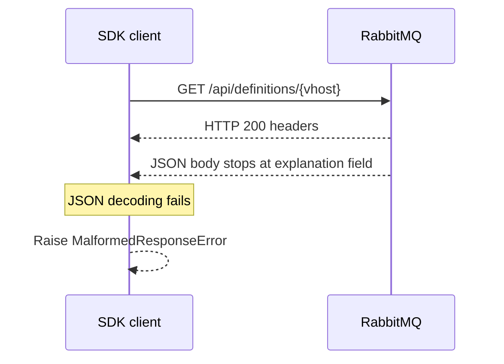

# Known broker limitations

## Non-ASCII virtual-host definitions exports

Live verification against RabbitMQ 4.2.9 and 4.3.6 found that
`GET /api/definitions/{vhost}` can return HTTP 200 with incomplete JSON when the
vhost name contains `é`. The response stops immediately after the `explanation`
field's colon. Creating, reading, and deleting the same vhost work correctly.
The SDK's URL path encoding is also verified independently with captured
request paths.

The broker's [4.3.6 definitions export implementation](https://raw.githubusercontent.com/rabbitmq/rabbitmq-server/v4.3.6/deps/rabbitmq_management/src/rabbit_mgmt_wm_definitions.erl)
streams the JSON response after sending status 200. The observed failure is
therefore surfaced by the SDK as `MalformedResponseError`; the SDK does not
invent missing capture contents or silently treat the result as an empty export.

HTTP status and response validity are separate checks. The broker can send a
success status before finishing the body; the client still needs a complete
JSON document:

The live test
[test_non_ascii_vhost_export_surfaces_broker_streaming_failure](../tests/live/test_client_boundaries.py) documents this
specific failure as an expected failure. It accepts a complete, correctly
parsed response if a broker version fixes the issue. Other malformed-response
patterns and HTTP failures still fail the test.

This limitation is separate from standard URL encoding and from the successful
queue, exchange, binding, and UTF-8 authentication round trips. Verify the
export produced by your broker before relying on it as an offline capture.

The versions above identify the reproduced failure; they do not establish
whether every later patch is affected. If an incomplete body is saved to a
file, `ClusterAuditor.from_files()` raises `TopologyLoadError` while decoding
it. See the auditing guide's
[error table](topology-auditing.md#diagnose-loading-and-analysis-errors) for the
different loading boundaries. The auditor requires a cluster-wide export;
a valid single-vhost export has a different schema and is not interchangeable.
