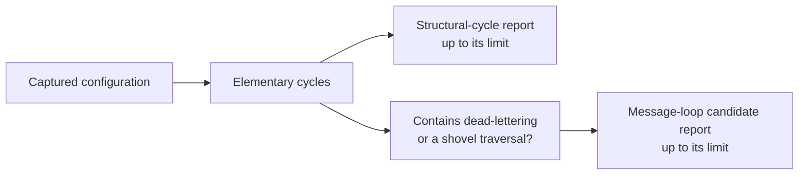
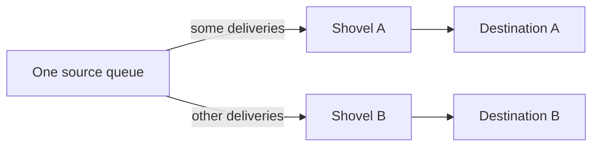
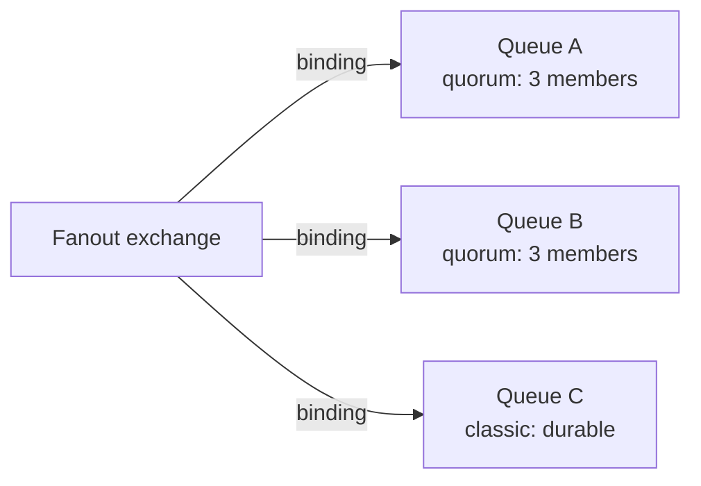

# Auditing RabbitMQ routing topology

`ClusterAuditor` turns captured RabbitMQ configuration into an immutable graph
and reports routes that deserve review. It does not inspect live messages, and
you do not need to know graph theory to start.

## RabbitMQ terminology

| Term | Meaning in this guide |
| --- | --- |
| Virtual host (vhost) | A namespace for queues, exchanges, and bindings. Two vhosts can contain different resources with the same name. |
| Exchange | The component that decides where a published message goes next. |
| Queue | The component that holds messages for consumers. |
| Binding | A configured connection from an exchange to a queue or another exchange. |
| Routing key | A string sent with a publication. An exchange can compare it with the keys on its bindings. |
| Direct exchange | An exchange that follows bindings whose key exactly matches the publication's routing key. |
| Dead-lettering | Republishing a message from a queue to its configured dead-letter exchange after an event such as rejection or expiration. |
| Shovel | A RabbitMQ component that consumes messages from one endpoint and republishes them to another. |
| Fanout exchange | An exchange that routes to every bound destination without selecting by routing key. |
| Quorum queue | A queue whose members replicate its data; one member is the leader. |
| Definitions export | Saved declarations and configuration from the Management API, excluding messages. |
| Resource observations | Queue and exchange records read from the Management API, including the policy the broker selected and available queue membership. |
| Hop | One directed connection in the topology graph. |
| Route | A sequence of one or more hops through exchanges, queues, or shovels. |

A *cycle* is a route that can lead back to where it started. For example, an
exchange sends to a queue, and that queue dead-letters messages back to the
exchange. The auditor reports *elementary cycles*: circular routes that repeat
no resource except the implicit return to their starting resource.

For an offline first run,
[build a small graph from an in-memory capture](topology-graph-construction.md#a-small-runnable-example).
You can also [replay a saved broker capture](#audit-from-files) from this repository.

## Quick start: run a bounded audit

Install the SDK as shown in the [README](../README.md#installation). This
example requires a reachable RabbitMQ broker with the management plugin and
an account that can export cluster-wide definitions and list resources across
all vhosts. Set `RABBIT_HOST`, `RABBIT_USER`, and `RABBIT_PASS` in your process
environment; `RABBIT_PORT` defaults to `15672`. For TLS configuration, see the
[authentication and TLS examples](../README.md#authentication).

Capture the inputs while the client is open, then analyze them locally:

```python
import os

from pydantic import SecretStr

from rabbitmq_management_sdk import Config, RabbitMQClient

config = Config(
    host=os.environ["RABBIT_HOST"],
    port=int(os.environ.get("RABBIT_PORT", "15672")),
    username=os.environ["RABBIT_USER"],
    password=SecretStr(os.environ["RABBIT_PASS"]),
)

with RabbitMQClient(config) as client:
    capture = client.collect_audit_capture()

auditor = capture.to_auditor()

# Limit each cycle report to at most 100 results.
report = auditor.audit(max_cycles=100)

for cycle in report.message_loop_candidates.cycles:
    print("Possible message loop:", cycle)

print("Dangling hops:", len(report.dangling_edges))
print(
    "Queues without a captured incoming hop:",
    len(report.queues_without_declared_ingress),
)

if report.message_loop_candidates.truncated:
    print("More message-loop candidates exist.")
if report.structural_cycles.truncated:
    print("More structural cycles exist.")
```

The `with` block closes the client's HTTP connections. `ClusterAuditor` then
works with the captured values offline. To save the inputs and acquisition
manifest, see [Collect, save, and replay an audit capture](capture-contract.md#collect-save-and-replay-an-audit-capture).
A cycle limit
bounds the output, not the time taken; see
[Keep cycle searches bounded](#keep-cycle-searches-bounded).

The definitions export is required when constructing a topology from captured
inputs. Queue and exchange observations are an all-or-nothing pair. They can
establish which policy supplied a routing value and resolve referenced
predeclared exchanges. See
[Prepare complete audit inputs](#prepare-complete-audit-inputs).

> Captured RabbitMQ data can contain credentials and internal identifiers. Do
> not commit an unsanitized capture. See
> [Treat captured data as sensitive](#treat-captured-data-as-sensitive).

## Audit an existing normalized topology

Use `from_topology()` when trusted application code already has a
`ClusterTopology`, such as after transferring the graph to an isolated worker
process:

```python
worker_auditor = ClusterAuditor.from_topology(topology)
report = worker_auditor.audit(max_cycles=100)
```

Every audit uses the supplied complete graph. The constructor does not filter
it, reparse a definitions export, or claim that its original capture was
complete. Because it retains no definitions, the `definitions` property raises
`TopologyAnalysisError` on this kind of auditor.

## Read the results in priority order

The audit returns two cycle reports:



Conceptually, every message-loop candidate is a structural cycle. With a
positive limit, however, `audit()` may search the two reports independently.
Check each report's `truncated` flag rather than assuming the displayed
candidate list was filtered from the displayed structural list.

### Message-loop candidates

Start with `report.message_loop_candidates`. Each result contains a
dead-letter edge or traverses a shovel. Dead-lettering can begin a new routing
operation after a message leaves a queue; a complete shovel traversal crosses
a consume-and-publish boundary.

These results are candidates, not proof that every message will loop. Routing
keys, topic patterns, and header matching may prevent a particular message from
following every hop. A compatible message can still repeat until an application
or broker condition stops it, so each candidate deserves review.

Quorum delayed retry and consumer timeouts do not remove configured routes or
add queue self-edges. Delayed retry changes when a returned message becomes
available again; consumer redelivery is outside this resource-route graph.
The auditor therefore retains the same cycle candidates with these settings.

Do not interpret backoff or a finite delivery limit as proof that repetition
will stop. In RabbitMQ 4.3, explicit non-failed returns such as `basic.nack` do
not increment the failed-delivery count used by the delivery limit. The auditor
does not simulate acknowledgements, counters, timeout firing, or consumer
behavior. See the [4.3 configuration guide](quorum-queue-configuration.md) and
[broker failure-counting rules](https://www.rabbitmq.com/docs/4.3/quorum-queues#poison-message-handling).

For example, RabbitMQ can drop a message after detecting a dead-letter cycle
with no rejection anywhere in that cycle. The auditor does not evaluate that
message history. See RabbitMQ's
[dead-letter cycle behavior](https://www.rabbitmq.com/docs/4.2/dlx#dead-letter-cycle).

### Structural cycles

`report.structural_cycles` contains circular routes declared in the captured
configuration, up to the requested limit. When `truncated` is `False`, it is a
complete inventory of circular routes that do not repeat an intermediate node
(called *elementary cycles*). This includes exchange-to-exchange binding
cycles.

RabbitMQ prevents a message from repeatedly traversing an exchange cycle within
one routing operation. The auditor still reports the configuration because it
is harder to reason about and may interact with a later dead-letter, binding, or
shovel change.

### Inspect one cycle

Each cycle is ordered as a message route. `nodes` contains the resource
identities visited; `edges` explains why each hop exists.

```python
# report is the TopologyAuditReport returned above.
for cycle in report.message_loop_candidates.cycles:
    print("Route:", cycle)
    for edge in cycle.edges:
        print(f"  {edge.kind}: {edge.source} -> {edge.target}")
```

For a route that reads:

```text
retry exchange -> retry queue -> retry exchange
```

review:

1. the binding from `retry` to `retry.queue`;
2. the queue's `x-dead-letter-exchange` argument or the broker-selected user
   policy that provides it; and
3. the conditions that dead-letter a message, such as TTL, rejection, queue
   length, or delivery limit.

The right correction may be to remove or redirect one hop or to add an
intentional stopping condition. Whether the route is a defect or a deliberate
retry workflow is an operational decision.

### Other useful findings

`audit()` also returns observations that can explain a cycle or reveal a
separate configuration issue:

| Finding | What it means | Typical next step |
| --- | --- | --- |
| `black_hole_exchanges` | A non-default exchange has no captured outgoing hop. | Confirm it is an intentional discard point. |
| `unreachable_internal_exchanges` | An internal exchange has no captured incoming hop. | Check bindings and alternate exchanges. |
| `queues_without_declared_ingress` | A queue has no captured inbound binding or confirmed-local shovel hop. | Confirm whether producers use RabbitMQ's default exchange. |
| `dangling_edges` | A captured hop names a queue or exchange absent from the graph. | Check declarations, spelling, and deployment order. |
| `direct_dependency_inventory` | Captured declarations and bindings that directly reference each queue or exchange, including missing resources. | Inspect the reference roles before changing a resource. |
| `cross_vhost_shovels` | A shovel's resolved source and destination vhost names differ. Locality and activity are separate findings. | Review both endpoint vhosts and confirm which broker each belongs to. |
| `competing_shovel_consumers` | Two or more shovels share one confirmed-local source queue, excluding known streams. | Confirm that distributing deliveries or consumer failover is intentional. |
| `shovel_safety` | Source acknowledgement timing and per-candidate transport on both legs of each dynamic shovel. | Review acknowledgement provenance and inspect both transport summaries. |
| `fanout_exchange_bindings` | Each fanout exchange and its distinct direct queue targets, with durability counts and complete or partial quorum-member totals. | Apply caller-defined thresholds and review unknown evidence alongside workload measurements. |
| `binding_durability` | Endpoint durability flags and documented classification for each captured binding. | Review flags for unknown and unclassified combinations. |
| `queue_declaration_compatibility` | Non-durable classic declarations evaluated against the RabbitMQ 4.3 default rule using observed exclusivity. | Compare the target broker's settings with the stated assumption. |
| `dead_letter_coverage` | Effective DLX settings and routing-compatible queue destinations, with explicit uncertainty. | Review absent settings, missing exchanges, and destination evidence; classify terminal/discard intent in the caller. |
| `exchange_routing_coverage` | Per-exchange destination evidence with an unknown routing key, following bindings and conditional alternates. | Inspect issues or call the individual method with a concrete key; classify intentional discard in the caller. |
| `routing_contracts` | Optional verdicts for caller-specified conditions on the queue destinations of an exchange and key. | Compare established destinations and uncertain branches against the supplied conditions. |
| `queue_type_inventory` | Queue identities and counts by type, across the cluster and per vhost, with captured vhost defaults. | Review the mix of classic, quorum, and stream queues independently of defaults for future declarations. |
| `queue_limits` | Effective queue thresholds, message TTL, unused-queue expiry, and stream retention. | Review the setting evidence and linked dead-letter coverage. |
| `stream_retention` | Whether age or byte retention is configured for each declared stream, with segment size evidence. | Inspect unknown settings and apply workload-specific sizing criteria. |
| `vhost_permissions_inventory` | Ordinary and topic permission declarations and configured queue and connection caps by vhost. | Review captured grants and limit evidence for the vhost. |
| `policy_inventory` | Declared regular and operator policies, the resources observed selecting them, and per-resource selection evidence. | Look up a policy by complete identity and check for missing evidence. |
| `quorum_delivery_configuration` | Per-quorum delivery settings, evidence, uncertainty, and advisory facts. | Review retry behavior, counted-delivery limits, timeouts, and dead-letter strategy alongside cycle findings. |
| `quorum_resilience` | Quorum majority thresholds, reported online margins, broker placement, and explicit failure scenarios. | Review captured member and leader concentration and which queues would lose a majority under the supplied scenario. |
| `shovels_with_unconfirmed_endpoints` | A shovel endpoint was not confirmed local. | Check `in_cluster_amqp_hosts`, URI support, and whether the endpoint belongs to another broker. |
| `shovels_with_unresolved_vhost` | The auditor could not determine a shovel endpoint's virtual host. | Inspect the shovel URI and address settings. |

These are facts from captured configuration, not runtime guarantees or
automatic errors. A bindingless exchange can intentionally discard messages,
and a queue can receive messages through RabbitMQ's default exchange without an
explicit binding. The default exchange itself is excluded from
`black_hole_exchanges` because its implicit queue routes are not present in a
definitions export.

### Implemented capabilities and evidence

The table below describes current APIs, not proposed audit features.
Single-capture analyses operate on the normalized graph, including through
`from_topology()`. Capture comparisons also use retained source evidence.
The evidence column explains what must have been captured during construction
to obtain the corresponding facts. Queue and exchange observations, when used,
must be supplied as a complete pair. The [capture contract](capture-contract.md)
explains scope, field presence, and provenance limitations.

The [SDK collector](../src/rabbitmq_management_sdk/client/audit_capture.py)
captures that pair and the cluster definitions. Its
[integration tests](../tests/integration/test_audit_capture.py) cover
pagination, publication, sanitization, and audit replay with saved evidence.

| Facade methods / report fields | Evidence needed | Limits and uncertainty | Implementation and focused tests |
| --- | --- | --- | --- |
| `structural_cycles`, `message_loop_candidates`; also SCC methods | Contained route nodes/edges; policy and locality evidence when those determine edges | Dangling hops excluded; caps may truncate; candidates are not proven runtime loops | [Cycles](../src/rabbitmq_management_sdk/topology/cycles.py), [cycle tests](../tests/unit/test_cycles.py) |
| `black_hole_exchanges`, `unreachable_internal_exchanges`, `queues_without_declared_ingress`, `dangling_edges` | Declared endpoints and captured edges | Degree-only facts; default exchange and dangling-endpoint rules differ from contextual routing | [Reachability](../src/rabbitmq_management_sdk/topology/reachability.py), [degree tests](../tests/unit/test_reachability.py), [model tests](../tests/unit/test_models.py) |
| `direct_dependencies(resource)`, `direct_dependency_inventory` | Captured bindings, resolved DLX and alternate routes, and fixed, confirmed-local shovel endpoints | Direct references only. Missing target nodes are retained. Implicit default-exchange bindings are outside the inventory. | [Dependency analysis](../src/rabbitmq_management_sdk/topology/dependencies.py), [unit tests](../tests/unit/test_direct_dependencies.py), [4.2 and 4.3 captures](../tests/integration/test_direct_dependency_captures.py) |
| `cross_vhost_shovels`, `shovels_with_unconfirmed_endpoints`, `shovels_with_unresolved_vhost` | Normalized endpoint vhosts/authorities and caller local-host mapping | Unconfirmed is not necessarily remote; cross-vhost does not establish activity | [Reachability](../src/rabbitmq_management_sdk/topology/reachability.py), [endpoint parsing](../tests/unit/test_parser_shovels.py), [direction captures](../tests/integration/test_shovel_direction_captures.py) |
| `competing_shovel_consumers` | At least two confirmed-local queue sources with the same full identity; known type where declared | Known streams excluded; missing declarations retained; no consumer activity or loss claim | [Shovel audit](../src/rabbitmq_management_sdk/topology/shovel_audit.py), [shared-source tests](../tests/unit/test_shovel_audit.py) |
| `shovel_safety` | Dynamic shovel parameters, candidate URI shapes, and broker version for defaults and hostless AMQP 0-9-1 | Credential-free configuration evidence. Delivery and TLS peer verification require separate evidence. | [Shovel safety guide](shovel-safety.md), [unit tests](../tests/unit/test_shovel_safety.py), [captures](../tests/integration/test_shovel_direction_captures.py) |
| `fanout_exchange_bindings` | Fanout declarations/direct bindings; declared target type/durability and observed quorum members when available | Targets counted once; dangling attributes unknown; partial and complete membership totals differ | [Fanout](../src/rabbitmq_management_sdk/topology/fanout.py), [unit tests](../tests/unit/test_fanout.py), [captures](../tests/integration/test_fanout_captures.py) |
| `binding_durability`, `queue_declaration_compatibility` | Captured bindings with endpoint durability, and declared non-durable classic queues with optional observed `exclusive` | Parallel and dangling bindings retained. The queue finding evaluates a 4.3 default and leaves missing exclusivity indeterminate. | [Side-by-side example](declaration-compatibility.md), [implementation](../src/rabbitmq_management_sdk/topology/declaration_compatibility.py), [unit tests](../tests/unit/test_declaration_compatibility.py), [captures](../tests/integration/test_declaration_compatibility_captures.py), [live tests](../tests/live/test_declaration_compatibility.py) |
| `queue_type_inventory` | Declared queue types resolved from arguments/vhost defaults; captured vhost metadata | Missing defaults remain unknown; no queues invented from dangling references | [Inventory](../src/rabbitmq_management_sdk/topology/queue_inventory.py), [unit tests](../tests/unit/test_queue_inventory.py), [captures](../tests/integration/test_queue_inventory_captures.py), [live tests](../tests/live/test_queue_inventory.py) |
| `queue_limits` | Captured 4.2/4.3 version, queue arguments, selected/effective policies, and existing DLX coverage | Unknown, unset, and inapplicable remain distinct. Settings describe configuration at capture time. | [Queue limits guide](queue-limits.md), [unit tests](../tests/unit/test_queue_limits.py), [captures](../tests/integration/test_queue_limits_captures.py), [live tests](../tests/live/test_queue_limits.py) |
| `stream_retention` | Resolved stream age and bytes, with captured argument and current policy evidence for segment size | Both limits must be unset for `missing`. Applied segment size requires evidence beyond current declaration and policy values. | [Stream retention guide](queue-limits.md#classify-stream-retention), [implementation](../src/rabbitmq_management_sdk/topology/queue_limits.py), [unit tests](../tests/unit/test_queue_limits.py), [captures](../tests/integration/test_queue_limits_captures.py) |
| `vhost_permissions_inventory` | Ordinary and topic permission sections, vhost declarations, and vhost limit runtime parameters or embedded limit objects | Missing permission sections are unavailable. Patterns are kept verbatim. Caps describe captured declarations. | [Inventory example](vhost-permissions.md), [implementation](../src/rabbitmq_management_sdk/topology/vhost_permissions.py), [unit tests](../tests/unit/test_vhost_permissions.py), [captures](../tests/integration/test_vhost_permissions_captures.py) |
| `policy_inventory`, `policy_lookup(policy)` | Policy declaration headers and explicit regular/operator selections in resource observations | An omitted selector field differs from explicit null. Zero confirmed selections does not establish a policy is unused. | [Lookup example](policy-inventory.md), [implementation](../src/rabbitmq_management_sdk/topology/policy_inventory.py), [unit tests](../tests/unit/test_policy_inventory.py), [captures](../tests/integration/test_quorum_configuration_captures.py) |
| `dead_letter_coverage` | Resolved DLX edges, exchange types/bindings, and fixed key if configured | Streams inapplicable; terminal queues retained; selectors, missing resources, or plugin semantics can be uncertain | [DLX analysis](../src/rabbitmq_management_sdk/topology/dead_letter.py), [shared routing/selector tests](../tests/unit/test_dead_letter.py), [captures](../tests/integration/test_dead_letter_captures.py), [live tests](../tests/live/test_dead_letter_coverage.py) |
| `exchange_routing_coverage` | Contained exchanges and bindings; optional caller routing key for the individual method | Aggregate key is unknown; empty key is concrete; headers/plugins may remain unknown | [Exchange analysis](../src/rabbitmq_management_sdk/topology/exchange_routing.py), [unit tests](../tests/unit/test_exchange_routing.py), [captures](../tests/integration/test_exchange_routing_captures.py), [live tests](../tests/live/test_exchange_routing_coverage.py) |
| `evaluate_routing_contracts(contracts)`, `routing_contracts` | Same routing evidence, with caller-supplied origins, keys, and destination conditions | Direct client publication with one key; unknown selectors and open branches can leave a verdict undetermined | [Routing contracts](exchange-routing-coverage.md#caller-defined-routing-contracts), [unit tests](../tests/unit/test_routing_contracts.py), [4.2 and 4.3 captures](../tests/integration/test_routing_contract_captures.py) |
| `compare_captures(before, after)`, `before.compare(after)` | Same-cluster ID or explicit mapping, captured definitions sections, optional paired observations and routing contracts | Deltas use the shared vhost scope. Omitted sections, binding arguments, and observed selectors can make categories indeterminate. | [Comparison example](capture-comparison.md), [implementation](../src/rabbitmq_management_sdk/client/capture_comparison.py), [unit tests](../tests/unit/test_capture_comparison.py), [saved bundle replay](../tests/integration/test_audit_capture.py) |
| `quorum_delivery_configuration` | Declared quorum queues; captured 4.2/4.3 version, arguments, and selected/effective policy evidence | Known/unset/unknown/inapplicable differ; missing global defaults stay unknown; retry/timeouts inapplicable on 4.2 | [Resolver](../src/rabbitmq_management_sdk/topology/quorum_configuration.py), [advisories](../src/rabbitmq_management_sdk/topology/quorum.py), [unit tests](../tests/unit/test_quorum_configuration.py), [captures](../tests/integration/test_quorum_configuration_captures.py), [live audit](../tests/live/test_quorum_audit.py), [live configuration](../tests/live/test_quorum_configuration.py) |
| `quorum_resilience` | Declared quorum queues, captured member/leader/online identities, and optional caller domain assignments and failure scenarios | Missing placement or domain data can leave conclusions unknown; reported online majority describes the capture | [Resilience analysis](../src/rabbitmq_management_sdk/topology/quorum_resilience.py), [unit tests](../tests/unit/test_quorum_resilience.py), [captures](../tests/integration/test_quorum_resilience_captures.py) |

Shared checks belong in [public model tests](../tests/unit/test_models.py),
[facade tests](../tests/unit/test_cluster_auditor.py), and
[process-transfer tests](../tests/integration/test_cluster_auditor_process.py).
The [complex-topology assertions](../tests/shared/complex_topology.py) connect
multiple findings to the [captured demo](../tests/integration/rmq-4.3/complex-topology/README.md).
Graph translation has its own [parser test map](topology-graph-construction.md#implementation-and-test-map).
When changing shared routing selectors, keep their detailed coverage in the DLX
suite and test exchange/DLX public result compatibility separately.

### Direct dependencies before changing a resource

Use `auditor.direct_dependencies(resource)` with a full `NodeId` to review
which captured configuration refers to one queue or exchange. Each
`DirectReference` has a `role` relative to the resource you looked up.

| Role | What `related` identifies |
| --- | --- |
| `binding_source` | The destination queue or exchange of a binding sourced at this exchange. |
| `binding_target` | The source exchange of a binding targeting this queue or exchange. |
| `dead_letter_exchange` | The queue whose configuration names this exchange for messages that RabbitMQ dead-letters. |
| `alternate_exchange` | The exchange whose configuration names this exchange as a fallback when it has no matching immediate binding destination. |
| `shovel_source` | The shovel that names this resource as its source. The message hop runs from the resource to the shovel. |
| `shovel_destination` | The shovel that names this resource as its destination. |

For example, `orders.dlx` can be a queue's DLX, another exchange's alternate,
the source of a binding to `parking`, and a shovel's source. The lookup
reports each relationship independently. A self-binding appears under both
binding roles. Bindings retain their captured keys and canonical JSON
arguments so parallel bindings stay distinct. DLX key overrides and fixed
exchange shovel keys also remain visible, including empty strings.

Run this offline from the repository root using the saved RabbitMQ 4.3 demo.
The shovel host mapping identifies the demo broker's local endpoints.

```python
from pathlib import Path

from rabbitmq_management_sdk import ClusterAuditor
from rabbitmq_management_sdk.topology import NodeId, NodeKind

capture = Path("tests/integration/rmq-4.3/complex-topology")
auditor = ClusterAuditor.from_files(
    capture / "full-export-definitions.json",
    queues_path=capture / "queues.json",
    exchanges_path=capture / "exchanges.json",
    in_cluster_amqp_hosts={"127.0.0.1"},
)
for name, kind in [
    ("complex.fallback", NodeKind.EXCHANGE),
    ("complex.entry", NodeKind.EXCHANGE),
]:
    resource = NodeId("topology-demo.region-b", name, kind, auditor.cluster_id)
    result = auditor.direct_dependencies(resource)
    assert result is not None
    for reference in result.references:
        print(name, reference.role.value, reference.related.name)
```

```text
complex.fallback alternate_exchange complex.entry
complex.fallback binding_source complex.work.q
complex.entry shovel_destination complex.ab
```

Use `auditor.direct_dependency_inventory()` or
`report.direct_dependency_inventory` for the complete inventory.
`DirectDependencyInventory.resources` is in canonical node order, and
`by_resource` is a read-only mapping keyed by full `NodeId`. Within each
row, references are ordered by role, related identity, key, then arguments.
The auditor builds the index once on first use and reuses it for later
lookups. An identity absent from both the graph and the reference index
returns `None` from `direct_dependencies()`. A contained resource with no
references has an empty tuple. A referenced resource absent from the graph
has `is_present=False` and retains its references.

Both RabbitMQ 4.2 and 4.3 use the same analysis of retained graph evidence.
DLX and alternate relationships reflect resolved configuration, including
broker-selected policies when needed. A shovel side needs a fixed resource
and confirmed locality. Implicit default-exchange routes are outside the
captured bindings. The inventory answers questions about direct configuration
references. Message traffic, downstream effects, and deletion decisions
require other evidence.

### Shovels sharing a source queue

Two shovels reading one ordinary queue are two consumers of that queue. They
can share deliveries; this does not give each destination its own copy:



The arrows illustrate possible work sharing, not a prediction of which shovel
receives a particular message or how evenly deliveries are divided.

Use `report.competing_shovel_consumers`, or call
`auditor.competing_shovel_consumers()` for this finding alone. Each immutable
`CompetingShovelConsumers` value contains the source queue's `NodeId` in
`queue` and the complete, deterministically ordered tuple of `ShovelNode`
values in `shovels`:

```python
for group in report.competing_shovel_consumers:
    print("Review shared source queue:", group.queue)
    for shovel in group.shovels:
        print("  Configured consumer:", shovel.id)
```

For ordinary queues, shovels consuming from the same queue can divide its
deliveries. If every destination expects every message, some destinations may
therefore miss messages delivered to another shovel. This is an advisory
finding, not proof of broker message loss: work sharing and failover may be
intentional. Consumer activity, priorities, prefetch, and single-active-consumer
settings affect runtime behavior and are not evaluated. See RabbitMQ's
[consumer dispatch documentation](https://www.rabbitmq.com/docs/4.2/consumers).

The check compares the source cluster, vhost, and queue name. Shovels can be
declared in different vhosts, use different supported AMQP protocols or host
aliases, and publish to any destination. Only their sources must be confirmed
local; remote destinations do not suppress the warning. Shared destination
queues and exchange sources do not produce this finding.

Unconfirmed or unresolved sources are excluded, including a failover URI list
with any unconfirmed host. A missing queue declaration still produces a group
when the source evidence establishes the shared local identity; its queue type
is unknown and dangling edges remain separately reported. Known stream queues
are excluded because they allow
[non-destructive consumption](https://www.rabbitmq.com/docs/4.2/streams#what-is-a-stream).
Other queue types remain advisory; the audit does not establish the consumer
semantics of plugin queue implementations.

### Fanout exchanges and quorum replication

A fanout exchange can send one publication to several queues. Each quorum
queue then has its own replication group:



Here there are three distinct direct queue targets. The two quorum queues
account for six captured queue members; the classic queue has no quorum
replication factor. A Python `None` means unknown or not applicable, never
zero members.

Use `auditor.fanout_exchange_bindings()`, or
`report.fanout_exchange_bindings` from the complete audit. The method returns a
tuple of frozen `FanoutExchangeBindings` dataclasses. Each contains the
`ExchangeNode` in `exchange` and a tuple of `FanoutQueue` values in `queues`.
Both tuples use canonical identity ordering. These result types are exported
from `rabbitmq_management_sdk.topology`.

```python
for group in auditor.fanout_exchange_bindings():
    print(group.exchange.id.vhost, group.exchange.id.name)
    for queue in group.queues:
        print(queue.id.name, queue.queue_type, queue.durable, queue.replication_factor)
```

Every fanout exchange present in the graph appears, including those with no
direct queue bindings. Each queue identity includes the cluster, vhost, and
name, so same-named exchanges and queues in separate vhosts remain separate.
Parallel bindings to one queue count once. A queue target whose declaration
is missing remains visible with `queue_type=None`, `durable=None`, and
`replication_factor=None`; its binding also remains in `dangling_edges`.
Known durability comes from the queue declaration, independently of message
persistence. A manually constructed `FanoutQueue` that omits durability also
retains `None`; the SDK does not infer durability from its queue type.

Each `FanoutExchangeBindings` value derives these metrics from its immutable
`queues` tuple. They cannot contradict the retained queue values:

| Property | Meaning |
| --- | --- |
| `queue_count` | Distinct direct queue targets, including dangling targets. |
| `durable_queue_count` | Targets whose captured durability is `True`. |
| `non_durable_queue_count` | Targets whose captured durability is `False`. |
| `unknown_durability_count` | Targets without durability evidence. |
| `quorum_queue_count` | Targets known to be quorum queues. |
| `unknown_queue_type_count` | Targets whose queue type is unknown. |
| `quorum_queues_without_membership_count` | Known quorum targets without a captured membership count. |
| `known_quorum_member_count` | Sum of available quorum membership counts, including each queue's leader. This can be partial. |
| `quorum_member_count` | Complete quorum-member sum, or `None` if any target type or quorum membership is unknown. |

The durability counts partition `queue_count`. A missing target can be a
quorum queue, so its unknown type also prevents a complete quorum-member sum.
Unknown durability alone does not hide otherwise known quorum membership.

| Direct targets | Known quorum members | Complete quorum members |
| --- | --- | --- |
| No targets | `0` | `0` |
| Only known classic, stream, or plugin types | `0` | `0` |
| One quorum queue with 3 captured members | `3` | `3` |
| That queue plus a quorum queue with unknown membership | `3` | `None` |
| That queue plus a dangling queue target | `3` | `None` |

These totals concern quorum queues only. Zero quorum members does not mean
zero storage or replication cost for streams or plugin types. Members are
counted per queue, so two queues with three members on the same three broker
nodes contribute six queue memberships, not six distinct broker nodes.

From the repository root, this complete example loads the saved RabbitMQ 4.3
demo and reports the mixed classic/quorum/stream fanout:

```python
from pathlib import Path

from rabbitmq_management_sdk import ClusterAuditor

capture = Path("tests/integration/rmq-4.3/complex-topology")
auditor = ClusterAuditor.from_files(
    capture / "full-export-definitions.json",
    queues_path=capture / "queues.json",
    exchanges_path=capture / "exchanges.json",
)
group = next(
    group
    for group in auditor.fanout_exchange_bindings()
    if (group.exchange.id.vhost, group.exchange.id.name)
    == ("topology-demo.routing", "route.fanout")
)
print("Direct queues:", group.queue_count)
print("Durable queues:", group.durable_queue_count)
print("Quorum queues:", group.quorum_queue_count)
print("Known quorum members:", group.known_quorum_member_count)
print("Complete quorum members:", group.quorum_member_count)
```

Expected output from this single-broker demo:

```text
Direct queues: 3
Durable queues: 3
Quorum queues: 1
Known quorum members: 1
Complete quorum members: 1
```

The replication factor belongs to each queue, rather than to the exchange.
For quorum queues it is the captured Management API `members` count,
including the leader. Supply the paired `queues` and `exchanges` observations
to `ClusterAuditor`, or their JSON snapshots to `from_files()`, to retain this
evidence. Missing or empty membership, definitions-only captures, and other
queue types return `None`. The parser does not substitute the initial group
size, the cluster's node count, or the number of online members. Membership
can change after declaration; see RabbitMQ's
[quorum membership documentation](https://www.rabbitmq.com/docs/4.2/quorum-queues#replication-factor-and-membership-management).
The count is retained on `QueueNode.replication_factor`, including after
trusted graph serialization and reconstruction through `from_topology()`.

This audit includes only direct exchange-to-queue bindings. It does not
traverse exchange-to-exchange bindings, alternate exchanges, dead-letter
routes, or shovels. A fanout exchange with no direct queues can still route
through another exchange. RabbitMQ's
[exchange routing documentation](https://www.rabbitmq.com/docs/exchanges)
describes those additional routes.

Fanout combined with quorum replication is useful capacity evidence, not
proof of a bottleneck. For example, 15 distinct quorum queues with three
members each represent 45 queue members that can retain a publication. This
is not an exact physical disk-write or bandwidth estimate: message rates,
payload sizes, batching, persistence, and broker storage behavior affect the
actual cost. Apply workload measurements and operational thresholds outside
this SDK finding.

There is no built-in queue-count cutoff or bottleneck verdict. Consumers choose
their own limits and decide how to handle incomplete evidence. RabbitMQ's
[quorum queue use-case guidance](https://www.rabbitmq.com/docs/4.2/quorum-queues#when-not-to-use-quorum-queues)
discusses large fanouts, while its
[storage documentation](https://www.rabbitmq.com/docs/4.2/quorum-queues#how-memory-wal-and-segments-files-interact)
explains that quorum queues on a node share a write-ahead log. Member counts
therefore describe the configured replication groups, not physical I/O counts.

### Routing-aware exchange coverage

Use `auditor.exchange_routing_coverage(routing_key="orders.failed")` to
evaluate captured exchange routes for that publication key. Results distinguish
no contained queue destination, a possible destination, and undetermined
routing. Omitting the key leaves key-dependent selectors unresolved; `""`
is an explicit empty key. Headers requiring message values remain unknown.

`report.exchange_routing_coverage` uses the unknown-key context. The existing
`black_hole_exchanges()` remains a degree-only finding. A key-specific routing
failure does not classify every publication to that exchange as unroutable.
See the [exchange routing guide](exchange-routing-coverage.md) for a runnable
example and the shared engine's scope.

### Quorum delivery configuration

Use `auditor.quorum_delivery_configuration()` or the identically named report
field for every declared quorum queue. The graph retains the frozen evidence,
including through `from_topology()`. Missing defaults or selection evidence
remain unknown. These settings annotate audit interpretation without removing
cycle candidates. See [quorum queue auditing](quorum-queue-auditing.md) for a
complete example and the 4.2/4.3 resolution rules.

### Quorum resilience

Use `auditor.quorum_resilience()` or the identically named report field for
per-queue majority and failure margins and per-broker member and leader
concentration. Both `quorum_resilience()` and `audit()` accept
`failure_domains` and `scenarios` for evaluating explicit losses. See the
[RabbitMQ 4.2 and 4.3 resilience guide](quorum-resilience.md).

### Effective dead-letter coverage

Use `auditor.dead_letter_coverage()` or `report.dead_letter_coverage` for a
result per queue. The analysis distinguishes absent settings, missing DLX
exchanges, no matching destination, possible destinations, and undetermined
routing. Terminal queues remain visible, and streams are explicitly not
applicable. The [DLX coverage guide](dead-letter-coverage.md) explains routing
keys, conditional alternate exchanges, uncertainty reasons, and the boundary
between possible routing and runtime delivery.

### Queue types and vhost defaults

A vhost can default to quorum queues while still containing classic queues.
RabbitMQ's default applies when a new queue declaration omits its type;
changing that default does not change existing queues. See the
[RabbitMQ default queue type documentation](https://www.rabbitmq.com/docs/4.2/vhosts#default-queue-type-dqt).
The inventory reports these facts separately and does not classify classic
queues or a difference from the default as an error.

Call `auditor.queue_type_inventory()` for this inventory alone, or read
`report.queue_type_inventory` after `audit()`. To try it from the repository
root using the saved RabbitMQ 4.3 demo:

```python
from pathlib import Path

from rabbitmq_management_sdk import ClusterAuditor

capture = Path("tests/integration/rmq-4.3/complex-topology")
auditor = ClusterAuditor.from_files(
    capture / "full-export-definitions.json",
    queues_path=capture / "queues.json",
    exchanges_path=capture / "exchanges.json",
)
inventory = auditor.queue_type_inventory()
print("Total queues:", inventory.queue_count)
for group in inventory.queue_types:
    print(group.queue_type, group.queue_count)

policies = next(vhost for vhost in inventory.vhosts if vhost.vhost == "topology-demo.policies")
print("Policies vhost default:", policies.default_queue_type)
print("Existing types:", [(group.queue_type, group.queue_count) for group in policies.queue_types])
```

Expected output:

```text
Total queues: 46
classic 42
quorum 3
stream 1
Policies vhost default: quorum
Existing types: [('classic', 6), ('quorum', 1)]
```

`QueueTypeInventory.vhosts` contains `VhostQueueInventory` values ordered by
vhost name. Both cluster and vhost `queue_types` contain `QueueTypeGroup`
values ordered by type name. Each group has `queue_type`, `queue_count`, and
`queues`: the complete `QueueNode` values ordered by identity. Counts are
derived from those queues, and all returned values are immutable.

Declared empty vhosts appear with `queue_count=0` and `queue_types=()`.
Vhosts represented by resource nodes also appear when metadata is absent,
with `default_queue_type=None`. This reports the captured vhost setting;
the SDK does not infer a node-wide broker default or assume `classic`.
Dangling references and remote shovel endpoints do not invent inventory
entries. Only contained queue declarations contribute to counts.

Queue type names remain open strings in graph values and inventory groups.
The wire schemas currently accept only `classic`, `quorum`, and `stream`
for direct queue declarations and observations, so this does not promise
end-to-end support for plugin queue types.

Vhost metadata lives in `ClusterTopology.vhosts` and survives trusted graph
serialization and `ClusterAuditor.from_topology()`. A manually constructed
graph without that metadata can still inventory its queues, but cannot
recover an absent default or an empty vhost. Inventory analysis performs no
HTTP calls; the usual graph-construction evidence requirements still apply.

## Keep cycle searches bounded

Large or densely connected configurations can contain many circular routes.
Pass a positive limit while exploring an unfamiliar topology:

```python
# auditor is an already constructed ClusterAuditor.
result = auditor.structural_cycles(max_cycles=100)

for cycle in result.cycles:
    print(cycle)

if result.truncated:
    print("More cycles exist; this result was limited to 100.")
```

`max_cycles=0` requests every result and is the API default. Use it only when
the topology is known to be small enough for complete enumeration.

Even when a cycle result is truncated, `auditor.cyclic_components()` still
returns the complete set of regions that are capable of containing cycles.

The value must be an integer greater than or equal to zero. Negative values,
floats, and booleans raise `TopologyAnalysisError`. A positive cap does not
provide a timeout: candidate searches can inspect many nonmatching cycles
before finding the next candidate. Applications that need cancellation should
run expensive analysis in a worker process they can terminate.

## Prepare complete audit inputs

The auditor combines several kinds of evidence. Use the
[capture contract](capture-contract.md) for acquisition, provenance, field
presence, and sanitization requirements; this section shows the current facade
inputs and loading calls.

| Input | Purpose | Required? |
| --- | --- | --- |
| Definitions export | Supplies declared resources, bindings, parameters, policies, broker version, and cluster identity. | When constructing from captures; `from_topology()` uses an existing graph instead |
| Queue and exchange observations | Supply broker-selected and effective policies for limits, stream retention, and quorum delivery, plus referenced predeclared exchanges, queue exclusivity, and captured quorum members, leader, and online members. | Optional pair. Provides observation evidence and resolves routes that depend on a broker-selected policy. |
| `cluster_label` | Adds a human-friendly name to reports without changing identity. | Optional |
| `in_cluster_amqp_hosts` | Confirms which AMQP shovel hosts belong to this captured cluster. | Optional; relevant to shovels |

Queue and exchange observations must be supplied together as complete lists
from the same broker and capture window. The collector and `list_all()` read
bounded pages across visible vhosts with sequential HTTP requests. A capture's
consistency and scope depend on broker activity and account visibility.

Do not use `list_by_vhost()`, a name-filtered list, or a single page as a
cluster-wide snapshot. Those calls can leave out evidence needed to resolve a
route. The configured client's vhost does not restrict `list_all()` or
`admin.export_definitions()`.

### Policy-derived hops

RabbitMQ evaluates policy patterns with its Erlang regular-expression engine.
The auditor deliberately does not approximate that evaluation with Python's
regular-expression engine.

When a user policy can supply a dead-letter exchange, dead-letter routing key,
or alternate exchange, provide the complete broker-observed queue and exchange
records. Those records tell the auditor which policy RabbitMQ selected. Direct
queue or exchange arguments still take precedence for each configured value.

With definitions alone, a captured policy that could supply an unresolved
routing value can cause `TopologyParseError`. Supply observations with the
broker's selection to resolve it. Other gaps can leave a graph that the SDK
can build with uncertainty. For example, when a queue's argument map is
omitted and no observation supplies it, dead-letter coverage can report
`undetermined`. See the
[construction guide's policy cases](topology-graph-construction.md#policy-selection-and-incomplete-captures).

Definitions exports omit RabbitMQ's predeclared exchanges. Exchange
observations let the auditor resolve referenced standard, system, and plugin
exchanges. Without those observations, the auditor recognizes RabbitMQ's
guaranteed standard exchanges, such as `amq.topic`, but leaves an optional
system or plugin exchange dangling rather than guessing. Unreferenced
predeclared exchanges are not added because they cannot affect the captured
route graph.

### Audit from files

For a saved SDK bundle, use `AuditCapture.load(path).to_auditor()`.
Use the file loader below for separately acquired definitions and observation
arrays.

For a fully offline audit, save the same three inputs as JSON and load them with
`ClusterAuditor.from_files()`:

```python
from pathlib import Path

from rabbitmq_management_sdk import ClusterAuditor

auditor = ClusterAuditor.from_files(
    Path("full-export-definitions.json"),
    queues_path=Path("queues-get-all-no-stats.json"),
    exchanges_path=Path("exchanges-get-all-no-stats.json"),
    in_cluster_amqp_hosts={"rabbit-1.internal", "rabbit-2.internal"},
)

report = auditor.audit(max_cycles=100)
```

The definitions file must contain at least one recognized definitions array,
such as `vhosts`, `queues`, or `bindings`. Empty arrays are valid, so an empty
cluster export can still produce a clean audit. Older and manually prepared
definitions may omit version and format metadata. Empty objects, error
responses, single-vhost exports, and explicitly incompatible
`rabbitmq_definition_format` values raise `TopologyDefinitionsError` instead
of producing an empty graph.

The queue and exchange files must each contain a JSON array of Management API
records. If pagination was used to acquire them, flatten the pages first. The
auditor validates the files but cannot determine whether the source capture was
complete.

To try this from the repository root without a broker, use its sanitized test
captures:

```python
from pathlib import Path

from rabbitmq_management_sdk import ClusterAuditor

capture_dir = Path("tests/integration/rmq-4.2")
auditor = ClusterAuditor.from_files(
    capture_dir / "full-export-definitions.json",
    queues_path=capture_dir / "queues-get-all-no-stats.json",
    exchanges_path=capture_dir / "exchanges-get-all-no-stats.json",
)
report = auditor.audit(max_cycles=100)
print("Message-loop candidates:", len(report.message_loop_candidates.cycles))
for group in report.fanout_exchange_bindings:
    print(group.exchange.id.name, len(group.queues))
```

Expected output for the repository's captures:

```text
Message-loop candidates: 1
dest.fx 0
test.dlx 0
my-fan.dlx 1
src.fx 0
```

The zeroes mean no **direct queue targets**, not that the exchanges cannot
route through other exchanges.

The captures contain shovel hosts. Without `in_cluster_amqp_hosts`, hosted
endpoints remain unconfirmed; that is expected evidence of missing host
mapping, not a loading failure.

### Diagnose loading and analysis errors

A failed capture is different from an empty successful report. Fix the input
or request rather than replacing an error with empty lists:

| Exception | Example cause | Next step |
| --- | --- | --- |
| `TopologyLoadError` | Missing file, invalid UTF-8, or malformed JSON. | Check the path and obtain a complete JSON capture. |
| `TopologyDefinitionsError` | An error object or a single-vhost export was used as cluster definitions. | Use `admin.export_definitions()` and its cluster-wide shape. |
| `TopologyResourceSnapshotError` | A resource file contains a page object instead of an array, or an invalid record. | Flatten all pages and retain the required queue/exchange fields. |
| `TopologyParseError` | Queue type or selected-policy evidence cannot be resolved, or queue observations contradict definitions. | Read the contextual error and recapture consistent inputs. |
| `TopologyValidationError` | Graph values or normalized evidence violate a domain invariant. | Check node identities, edge kinds, and duplicate observations. |
| `TopologyAnalysisError` | Only one observation list was supplied, or `max_cycles` is invalid. | Supply both lists or neither, and use a nonnegative integer limit. |

These exceptions derive from `TopologyError`, which derives from
`RabbitMQError`; import them from `rabbitmq_management_sdk`. Directly calling a
Pydantic schema's `model_validate()` can instead raise
`pydantic.ValidationError`. `from_files()` wraps schema failures in the SDK
exceptions above and preserves the cause for debugging.

When a live HTTP response cannot be parsed, managers raise
`MalformedResponseError`. See the
[known definitions-export limitation](known-broker-limitations.md) for one
reproduced broker cause.

### Treat captured data as sensitive

Definitions can contain password hashes, grants, internal identifiers, and
credentials in URI userinfo or query parameters. Keep operational originals
outside version control and replay tests against a deliberately sanitized copy.
Follow the [capture contract](capture-contract.md#sanitize-without-changing-the-scenario)
for the maintained sanitization procedure, provenance requirements, and the
documented disposable-demo exception. A localhost-only export is not
automatically safe to publish. Rotate real credentials exposed by a shared
capture; see RabbitMQ's [definitions documentation](https://www.rabbitmq.com/docs/definitions).

### Confirm local shovel hosts

RabbitMQ exports a shovel's source and destination URI but does not identify
which hostnames belong to the current cluster. Pass every hostname that refers
to this cluster:

```python
from rabbitmq_management_sdk import ClusterAuditor

# definitions, queues, and exchanges are validated SDK response objects.
auditor = ClusterAuditor(
    definitions,
    queues=queues,
    exchanges=exchanges,
    in_cluster_amqp_hosts={
        "rabbit-1.internal",
        "rabbit-2.internal",
        "rabbit-lb.internal",
    },
)
```

The host mapping is an explicit admission rule:

- an unlisted AMQP host is not merged with a local resource, even when its
  queue or exchange name matches;
- an unlisted endpoint is reported as unconfirmed, not assumed to belong to a
  specific remote cluster;
- every host in a failover URI list must be confirmed local;
- all candidates for one shovel side must resolve to the same virtual host;
  and
- one malformed URI candidate invalidates that complete failover set.

When candidates disagree about the virtual host, the side is unresolved and
its local graph edge is omitted because RabbitMQ can select any candidate at
runtime. Authority and virtual-host evidence are parsed together; the auditor
does not combine values from different URI interpretations.

AMQP 1.0 shovel addresses retain RabbitMQ's address-version semantics. The
current `/exchanges/:exchange` form has a fixed empty routing key. The
deprecated `/exchange/:exchange` form has no fixed key and may obtain one from
each message, so the auditor does not invent a routing key.

### Understand cluster names and identity

The definitions export supplies RabbitMQ's `internal_cluster_id`, which becomes
`cluster_id`, and its configured `cluster_name`. If the global cluster-name
parameter is absent, the export's `original_cluster_name` snapshot is retained
as the available name evidence.

`cluster_label` is a separate presentation value. It defaults to the captured
broker name when omitted, but an explicit label never changes `cluster_name`,
node identity, or whether two clusters are considered the same.

## Advanced graph inspection

Most callers can use `audit()` and its report. The following APIs are useful
when building another presentation or investigating a dense cyclic region.

### Inspect strongly connected components

A strongly connected component (SCC) is a group in which every node can reach
every other node. The auditor exposes both the complete SCC partition and the
cyclic subset:

```python
# auditor is an already constructed ClusterAuditor.
components = auditor.strongly_connected_components()
cyclic_components = auditor.cyclic_components()
```

Every node present in the topology appears in exactly one item in `components`.
A singleton with no self-loop has `is_cyclic=False`. Every component with
multiple nodes is cyclic, as is a singleton with a self-loop.

Each component contains node identities rather than a copy of the graph.
Resolve resources through `auditor.topology.nodes_by_id`, or select each
component's internal edges:

```python
# cyclic_components and auditor are defined in the preceding example.
for component in cyclic_components:
    internal_edges = frozenset(
        edge
        for edge in auditor.topology.edges
        if edge.source in component.nodes and edge.target in component.nodes
    )
    print(component.nodes, internal_edges)
```

The complete SCC partition is graph analysis rather than an audit finding, so
it is available directly from `ClusterAuditor` and is not duplicated inside
`TopologyAuditReport`.

### Use the supported graph API

`ClusterAuditor` is the supported facade for loading captured JSON, normalizing
validated in-memory responses, and running topology audits. The report,
documented configuration inputs, and graph value types exported from
`rabbitmq_management_sdk.topology` are supported SDK interfaces.

```python
from rabbitmq_management_sdk import ClusterAuditor
from rabbitmq_management_sdk.topology import (
    ClusterTopology,
    StronglyConnectedComponent,
)


def inspect_graph(auditor: ClusterAuditor) -> None:
    topology: ClusterTopology = auditor.topology
    components: tuple[StronglyConnectedComponent, ...] = (
        auditor.strongly_connected_components()
    )
    print(len(topology.nodes), len(topology.edges), len(components))
```

`Cycle`, `CycleSearchResult`, `CompetingShovelConsumers`,
`DeadLetterCoverage`, `DeadLetterCoverageStatus`, `DeadLetterRoutingIssue`,
`DeadLetterUncertainty`,
`ExchangeRoutingCoverage`, `RoutingStatus`, `RoutingIssue`, `RoutingUncertainty`,
`RoutingContract`, `RoutingCondition`, `RoutingConditionKind`,
`RoutingContractResult`, `RoutingConditionResult`, `RoutingOriginStatus`, `RoutingVerdict`,
`DirectDependencyInventory`, `ResourceDependencies`, `DirectReference`,
`QueueLimits`, `QueueLimitsConfiguration`, `StreamRetention`, `StreamRetentionStatus`,
`VhostPermissionsInventory`, `VhostPermissions`, `VhostPermission`,
`VhostTopicPermission`, `VhostLimit`, `VhostLimitStatus`,
`PolicyId`, `PolicyKind`, `PolicyDeclaration`, `PolicyCoverage`,
`PolicyInventory`, `PolicySelection`, `PolicySelectionStatus`,
`ShovelSafety`, `ShovelAcknowledgement`, `ShovelAckMode`, `ShovelAckSource`,
`ShovelAckTiming`, `ShovelEndpointTransport`, `ShovelTransport`,
`DirectReferenceRole`,
`BindingDurability`, `BindingDurabilityKind`, `QueueDeclarationCompatibility`, `QueueDeclarationStatus`,
`FanoutExchangeBindings`, `FanoutQueue`, `QueueTypeInventory`,
`VhostQueueInventory`, `QueueTypeGroup`, `VirtualHostMetadata`, node values, endpoint
values, and edge values are also exported from
`rabbitmq_management_sdk.topology`. Consumers may translate the immutable
graph into another presentation format. It intentionally contains
no layout coordinates, colors, or other renderer-specific UI state.

Submodules such as `topology.parser`, `topology.cycles`, and
`topology.policy_routes` remain implementation details.

Contributors can follow the internal transformation from validated RabbitMQ
responses to the normalized graph in
[How RabbitMQ data becomes a topology graph](topology-graph-construction.md).

## What the audit cannot know

The audit evaluates captured configuration at one point in time. It does not
inspect live message counts, consumer behavior, publishing clients, or messages
already in queues. It also does not prove that every routing-key or header
combination can traverse a reported candidate.

Use the result to focus the review, then confirm message behavior in the
relevant application and RabbitMQ environment.
