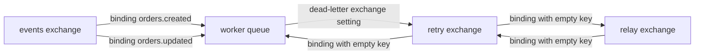
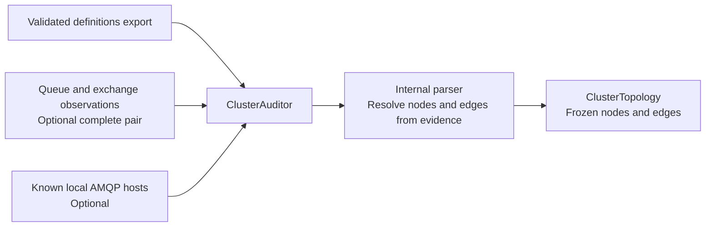
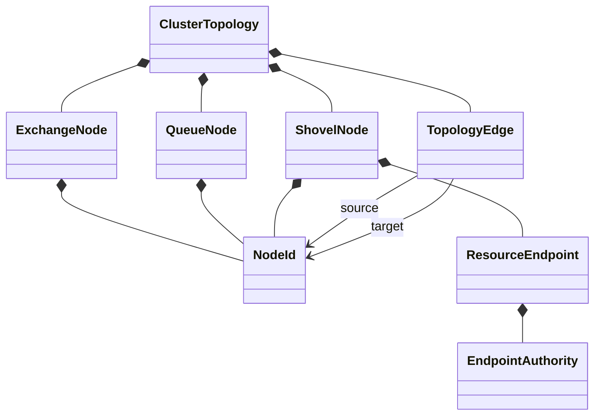
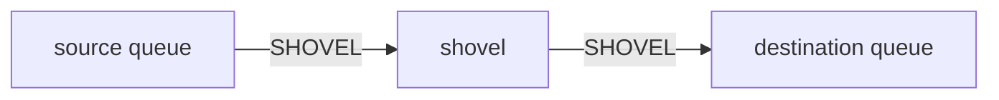
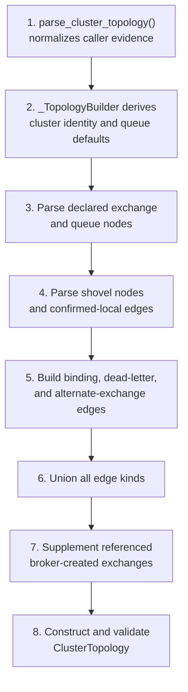

# How RabbitMQ data becomes a topology graph

An exchange named `events` can route to a queue named `worker`. When RabbitMQ
dead-letters a message from `worker`, it publishes through `retry`, an exchange
with a binding back to `worker`. In the topology graph, each resource becomes a
**node** and each configured step becomes a **directed edge**, an arrow from
source to destination. The two arrows between `worker` and `retry` form a
cycle. Whether a particular message can follow those arrows depends on the
publication and the binding rules.

For the RabbitMQ terms used here, see the
[auditing glossary](topology-auditing.md#rabbitmq-terminology).

## A small runnable example

All four resources below belong to the `orders` virtual host, a namespace for
resources. Two bindings connect `events` to `worker`, each with a different
binding key. A direct exchange follows a binding when the publication's routing
key equals that binding's key. `retry` also binds to `relay`, which has a
binding back to `retry`. The empty string is a key that can match a publication.



| Capture evidence | Graph value |
| --- | --- |
| Entries in `exchanges` and `queues` | Four nodes. Each `NodeId` includes the cluster, vhost, kind, and resource name. |
| Each row in `bindings` | One `BINDING` edge from `source` to `destination`, retaining its routing key. |
| `worker` has `x-dead-letter-exchange: retry` | A `DEAD_LETTER` edge from `worker` to `retry`. The queue supplies no override for the original routing key. |
| `orders` has default queue type `classic` | `worker` is a classic queue because its declaration omits `x-queue-type`. The vhost is stored as metadata. |

Install the [SDK](../README.md#installation) and run this complete example in
Python. The in-memory definitions stand in for a saved Management API export.
An explicit `policies: []` and captured exchange argument maps establish that
there are no alternate routes in this example. No broker connection is needed.

```python
from rabbitmq_management_sdk import ClusterAuditor
from rabbitmq_management_sdk.resources.v4.admin.schemas.export_response import (
    ClusterDefinitionsResponse,
)


def exchange(name: str) -> dict[str, object]:
    return {
        "name": name,
        "vhost": "orders",
        "type": "direct",
        "durable": True,
        "auto_delete": False,
        "internal": False,
        "arguments": {},
    }


def binding(source: str, destination: str, destination_type: str, routing_key: str) -> dict[str, object]:
    return {
        "source": source,
        "destination": destination,
        "destination_type": destination_type,
        "vhost": "orders",
        "routing_key": routing_key,
        "arguments": {},
    }


capture = {
    "global_parameters": [{"name": "internal_cluster_id", "value": "cluster-1"}],
    "vhosts": [{"name": "orders", "metadata": {"default_queue_type": "classic"}}],
    "exchanges": [exchange("events"), exchange("retry"), exchange("relay")],
    "queues": [
        {
            "name": "worker",
            "vhost": "orders",
            "durable": True,
            "auto_delete": False,
            "arguments": {"x-dead-letter-exchange": "retry"},
        },
    ],
    "bindings": [
        binding("events", "worker", "queue", "orders.created"),
        binding("events", "worker", "queue", "orders.updated"),
        binding("retry", "worker", "queue", ""),
        binding("retry", "relay", "exchange", ""),
        binding("relay", "retry", "exchange", ""),
    ],
    "policies": [],
}

auditor = ClusterAuditor(ClusterDefinitionsResponse.model_validate(capture))
topology = auditor.topology

assert {node.id.name for node in topology.nodes} == {"events", "worker", "retry", "relay"}
assert len(topology.edges) == 6
assert {edge.routing_key for edge in topology.edges if edge.source.name == "events"} == {
    "orders.created",
    "orders.updated",
}
assert not topology.dangling_edges()
```

The two `events → worker` edges share endpoints. They are *parallel edges*, and
the topology preserves their different keys. See how the auditor reports
[structural cycles and message-loop candidates](topology-auditing.md#read-the-results-in-priority-order),
or try the [dead-letter routing exercise](dead-letter-coverage.md#try-the-retry-graph)
to see how changing the key affects where a publication goes.

## The one-minute model

The same construction path handles a real capture. Optional queue and exchange
snapshots supply broker observations, and optional local AMQP host names help
resolve shovel endpoints. The internal parser translates validated data with no
HTTP requests or file I/O.



Graph identity is separate from resource attributes such as durability. Edge
kinds describe the possible movement, while arguments or broker-selected
policies supply the configuration evidence. Unresolved references stay visible
as evidence. The same capture yields the same identities, edges, and report
ordering.

## Supported and internal boundaries

Application code constructs graphs with `ClusterAuditor`, either from
validated responses or captured files:

```python
from pathlib import Path

from rabbitmq_management_sdk import ClusterAuditor
from rabbitmq_management_sdk.topology import ClusterTopology

auditor = ClusterAuditor.from_files(
    Path("full-export-definitions.json"),
    queues_path=Path("queues.json"),
    exchanges_path=Path("exchanges.json"),
)
topology: ClusterTopology = auditor.topology
```

An application that already owns a trusted, normalized topology can recreate
the public analysis facade without retaining or fabricating the original
definitions export:

```python
worker_auditor = ClusterAuditor.from_topology(topology)
cycles = worker_auditor.structural_cycles(max_cycles=100)
```

This is useful when transferring the smaller graph value to an isolated
analysis worker. It does not reparse source evidence or establish capture
completeness. A topology-backed auditor has no raw source export, so accessing
`worker_auditor.definitions` raises `TopologyAnalysisError`.

Graph and analysis values plus the canonical `node_sort_key` and
`edge_sort_key` helpers exported from `rabbitmq_management_sdk.topology` are the
supported domain contract. Parser, policy, ordering, reachability, and
cycle-function submodules are internal implementation details. Contributors
change and test those modules, but callers should use the facade.

`ClusterTopology.nodes` contains every typed node. The separate `exchanges`,
`queues`, and `shovels` collections provide kind-specific views.
`nodes_by_id` is an immutable identity lookup, and `edges` preserves every
distinct normalized hop, including parallel and dangling edges.
`vhosts` is a separate frozen set of `VirtualHostMetadata` values. Virtual
hosts are namespaces, so retaining them does not add routing nodes or edges.

## What each input contributes

| Input | Topology facts it supplies |
| --- | --- |
| `ClusterDefinitionsResponse` | Declared queues and exchanges, bindings, regular policies, runtime operator-policy parameters for quorum settings, declared vhosts/defaults, ordinary and topic permissions, vhost limits, shovel parameters, broker version, cluster identity, and cluster name |
| `QueueResponse` records | Selected regular/operator policy names and effective policy definitions, direct dead-letter arguments when the definition argument map is omitted, queue-type consistency, observed exclusivity, and available quorum members, leader, and online members for declared queues |
| `ExchangeResponse` records | Selected policy names when supplied, omitted alternate-exchange arguments, and attributes for referenced broker-created exchanges omitted by definitions exports |
| `in_cluster_amqp_hosts` | Evidence that hosted AMQP shovel endpoints belong to this cluster |
| `cluster_label` | Optional presentation label, independent of the captured broker name; it never changes graph identity or topology equality |

Definitions remain the authoritative source for declared queues and exchanges,
including their captured argument maps. A matching classic or quorum queue
observation can supply direct dead-letter settings when the definitions export
omits the entire queue argument map.

`ClusterTopology.vhost_permissions` retains a narrow, immutable projection
of ordinary and topic grants and vhost count caps. These declarations add
no routing nodes or edges. Section presence is captured during parsing, so
it survives trusted graph transfer. See the
[vhost inventory evidence](vhost-permissions.md#interpret-the-capture-evidence).

`ClusterTopology.policy_inventory` retains declaration headers and explicit
selection evidence, including the distinction between omitted and null
observation fields. The existing routing selection adapter continues to
resolve DLX and alternate routes separately. See the
[policy lookup evidence](policy-inventory.md#interpret-the-inventory).

Queue and exchange snapshots are an optional all-or-nothing pair at the public
facade. They must be complete lists from the same broker and capture window.
The calls need not be atomic, but the normalized domain does not carry an
“online,” “offline,” “complete,” “paginated,” or timestamp flag. The caller
owns completeness and temporal-consistency guarantees.
Follow the [capture contract](capture-contract.md) for acquisition scope,
missing/null values, provenance, and fixture sanitization. Validating an input
shape does not prove that every resource or field was captured.

## The domain model has identity and attribute layers

Graph algorithms need two things:

1. stable node identities; and
2. directed edges between those identities.

Audits additionally need resource attributes such as exchange type, queue
type, and shovel endpoint status. `models.py` keeps these concerns connected
without making algorithms depend on every RabbitMQ detail.



| Layer | Values | Purpose |
| --- | --- | --- |
| Identity | `NodeId` | Equality, hashing, and graph traversal |
| Attributes | `ExchangeNode`, `QueueNode`, `ShovelNode` | Resource facts used in reports |
| Hops | `TopologyEdge` | One directed step of possible message movement |
| Graph | `ClusterTopology` | Frozen collections and identity lookups |

### `NodeId` is the graph identity

A `NodeId` contains:

```python
NodeId(
    cluster_id="rabbitmq-cluster-id-example",
    vhost="orders",
    name="worker",
    kind=NodeKind.QUEUE,
)
```

Every field participates in equality and hashing:

- `kind` distinguishes a queue and exchange that share a name in one vhost;
- `vhost` distinguishes resources with the same name and kind;
- `cluster_id` prevents resources from independently exported clusters from
  being silently merged; and
- `name` is allowed to be empty because RabbitMQ's default exchange is named
  `""`.

`cluster_id` comes from RabbitMQ's `internal_cluster_id` global parameter. It
can be `None` for an older export, but such identities must not be used to
merge independently acquired clusters.

`cluster_name` preserves the broker-supplied name as evidence. The parser
prefers the `cluster_name` global parameter and falls back to the export's
top-level `original_cluster_name` when that parameter is absent. Because this
evidence can affect later composition, it participates in topology equality
and hashing.

`cluster_label` is deliberately separate from both `NodeId` and
`cluster_name`. It defaults to the captured broker name when the caller does
not supply one, but an explicit label never overwrites that evidence. It is
presentation metadata, is excluded from topology equality and hashing, and may
change without changing the broker or its resources.

All topology analysis uses one canonical node ordering:

```text
(cluster_id, vhost, name, kind)
```

The `cluster_id` position distinguishes identical resource coordinates from
different clusters. A present cluster ID sorts before a missing value, so
legacy unscoped captures remain deterministic without being treated as the
same identity. Edge ordering applies this same rule to both endpoints.

### Typed nodes are the attribute layer

`ExchangeNode`, `QueueNode`, and `ShovelNode` wrap a `NodeId` with facts needed
by audit operations:

- exchange type, `internal`, and durability;
- queue type, durability, captured quorum placement and replication factor,
  and optional quorum delivery configuration; or
- normalized, credential-free shovel connection candidates, fixed resource
  identity, and whether each endpoint is in this cluster.

The domain nodes store exchange and queue types as strings. Exchange types are
also open strings in the current definitions wire schema, so plugin exchange
types pass through the parser. `QueueNode` and a vhost's
`default_queue_type` can retain an arbitrary queue-type string. However,
direct definition `x-queue-type` values and `QueueResponse` observations
currently accept only `classic`, `quorum`, and `stream`. Plugin queue types
are therefore not supported end to end.

`ExchangeNode.is_default` identifies RabbitMQ's nameless default exchange
within its `NodeId.vhost`. It is a derived classification for consumers such
as topology visualizations; it does not remove the exchange from graph
analysis. Applications should run audits against the complete topology and
filter default exchanges only from their rendered view.

Graph algorithms read `ClusterTopology.all_node_ids` and map back through
`nodes_by_id` when a report needs resource attributes.

Quorum delivery settings are frozen metadata on `QueueNode.quorum_delivery`.
Limits and retention are frozen metadata on `QueueNode.queue_limits`. Both
use captured policy evidence, and quorum overflow is shared between them.
Stream metadata retains resolved age and byte retention, and declaration or
policy evidence for segment size. See the [queue limits guide](queue-limits.md)
for per-type rules.
The parser resolves captured 4.2/4.3 arguments and observed policy evidence,
retaining sources, nulls, and uncertainty. Missing global timeout defaults
stay unknown. This metadata changes resource attributes without changing
identities, route edges, or cycle paths. A delayed return stays within the
queue's delivery lifecycle. See [quorum queue auditing](quorum-queue-auditing.md).

### Policy-selection identity is cluster scoped

Policy evidence is an immutable `Mapping[NodeId, str | None]`. Queue and
exchange observations do not contain `internal_cluster_id`, so
`ClusterAuditor` obtains it from their paired definitions export when it builds
each mapping key. The resulting evidence cannot collide with the same vhost,
kind, and resource name captured from another cluster.

These states are different:

| State | Meaning |
| --- | --- |
| No mapping key for a resource | No broker observation was supplied |
| A present key with value `None` | The broker was observed selecting no regular user policy |
| A present key with a policy name | The broker selected that regular user policy |

`ClusterAuditor` reads the Management API's `policy` field. Operator policies
are separate operational constraints and do not create routing edges, so
`operator_policy` is not normalized into this mapping.
The separate quorum configuration resolver does consume observed
`operator_policy` and `effective_policy_definition`, retaining field presence
and setting-specific uncertainty. Do not extend the routing-selection map by
inventing operator-policy routes.

## Edges represent possible message movement

`TopologyEdge` expresses one directed RabbitMQ hop. `EdgeKind` answers “how
could a message move?”, while arguments, policies, bindings, and shovel
parameters answer “which captured configuration supplied the evidence?” Those
are different concerns:

| Edge kind | Valid direction | Configuration evidence |
| --- | --- | --- |
| `BINDING` | exchange → exchange or queue | Definitions binding |
| `DEAD_LETTER` | queue → exchange | Queue argument and/or selected regular policy |
| `ALTERNATE_EXCHANGE` | exchange → exchange | Exchange argument and/or selected regular policy |
| `SHOVEL` | resource → shovel and shovel → resource | Shovel parameter |

RabbitMQ has no special “dead-letter exchange” or “dead-letter queue” resource
type. A DLX is an ordinary exchange referenced by a queue's dead-letter
configuration. A dead-letter queue is an ordinary queue reached from that
exchange through bindings. Therefore policy provenance is not an edge kind:
both a direct argument and a selected policy produce the same
`DEAD_LETTER` behavior.

The shovel itself is a node. A resolvable queue-to-queue shovel therefore
becomes two edges:



This preserves the configured transport step and lets an audit report which
shovel participates in a route.

The [direct dependency audit](topology-auditing.md#direct-dependencies-before-changing-a-resource)
uses binding edges for both endpoint roles and resolved DLX and alternate
edges for their target roles. It reads normalized shovel endpoints so each
confirmed-local side ties the shovel declaration to the resource it names.
The audit uses this evidence through `from_topology()` without needing the
definitions export.

### Optional edge fields preserve real distinctions

`routing_key=None` means there is no fixed key on the captured edge, or that
the field does not apply. Depending on the route, RabbitMQ may retain a
message's existing routing key. `None` is distinct from `routing_key=""`,
which is a real, fixed RabbitMQ value.

Shovel key interpretation also depends on direction and protocol. An empty
AMQP 0-9-1 or `local` source exchange key selects a generated queue's binding
key, so the captured parameter yields `None`. An empty destination key remains
literal where the protocol defines it that way. See
[directional shovel resource evidence](#resource-evidence-and-edge-admission).

Binding arguments are stored as canonical, sorted JSON text. A binding
arguments dictionary cannot be placed directly in a hashable frozen edge, and
discarding it would collapse different headers bindings into one value. The
canonical string remains lossless and deterministic: fields absent from the
wire payload stay absent, while explicitly supplied `null` values are
preserved.

Only binding edges may carry `arguments`. Alternate-exchange edges cannot
carry a configured routing key because the message retains its existing key.
Queue-backed shovel edges cannot carry a routing key because a queue endpoint
already identifies the complete source or destination. Every non-shovel edge
must also remain within one `cluster_id` and vhost. These rules are enforced by
`TopologyEdge.__post_init__`.

## The parser runs in ordered phases

Inside the facade, `parse_cluster_topology()` normalizes supplied evidence and
hands it to one private `_TopologyBuilder`. The builder owns the definitions
response, cluster identity, vhost queue defaults, policy selections, observed
queues and exchanges, and confirmed local hosts. Its `build()` method makes
construction order explicit without passing that context through every phase:



The ordering has semantic importance. Supplementation is intentionally limited
to missing exchanges referenced by captured hops, so the parser must know the
edges first. Unreferenced observations are not part of the route graph. Domain
validation happens last, after every source has been combined.
`_TopologyBuilder` and `parse_cluster_topology()` are implementation details;
application code continues to use `ClusterAuditor`.

## Parsing declared resources

### Virtual hosts

Each exported vhost becomes `VirtualHostMetadata(name, default_queue_type)`
in `ClusterTopology.vhosts`. Names are scoped to the containing cluster;
this metadata is separate from `NodeId` and never changes resource identity.
The parser preserves absent defaults as `None` and rejects conflicting
metadata for the same vhost name. Empty declared vhosts remain visible even
when they contribute no routing nodes.

This retained metadata supports
[queue type inventory](topology-auditing.md#queue-types-and-vhost-defaults),
including after graph serialization and `from_topology()`. Manually built
graphs may omit `vhosts` (the default is an empty frozen set); resource names
can identify a vhost but cannot establish its default or recover empty vhosts.
Vhost defaults and resolved queue types remain separate captured facts.

### Exchanges

Each `ClusterExportExchange` becomes an `ExchangeNode`. Its type is preserved
verbatim, including plugin types such as `x-consistent-hash` or
`x-local-random`.

### Queues

Effective DLX coverage consumes the existing resolved `DEAD_LETTER` edges;
it adds no graph nodes, edges, or queue-name conventions. Binding keys and
canonical arguments provide its routing evidence. See the
[DLX coverage guide](dead-letter-coverage.md) for supported semantics and
uncertainty states.

[Exchange routing coverage](exchange-routing-coverage.md) likewise adds no
nodes or edges. It consumes retained exchange types, binding keys and
arguments, and resolved alternate routes. It shares exchange traversal with
DLX coverage; supplying a publication key affects analysis results, not graph
identity or stored configuration.

Each `ClusterExportQueue` becomes a `QueueNode`. Queue type resolution follows:

1. use the queue's `x-queue-type` argument when present;
2. otherwise use the declaring vhost's `default_queue_type`; and
3. fail if neither value is available.

The parser does not invent `classic` as a universal default. A broker export
that cannot determine the queue type cannot produce a precise normalized
queue node. It raises a `TopologyParseError` directly, identifying both the
queue and the vhost whose default is missing.

When paired resource observations are supplied to `ClusterAuditor`, a declared
quorum queue with a matching observation retains `QuorumPlacement` on
`QueueNode.quorum_placement`. It copies the Management API's `members`,
`leader`, and `online` fields. `replication_factor` is the count of nonempty
captured membership, including the leader. Initial group sizes, cluster node
counts, and online counts leave missing membership unresolved. Definitions
remain the source of queue declarations, and observations match by complete
queue identity.

`QueueNode.exclusive` is optional immutable metadata for the
[4.3 queue declaration check](declaration-compatibility.md#the-rabbitmq-43-default-queue-declaration-rule).
A matching observation supplies it when type and durability agree with the
declaration. Missing and null fields leave it unknown. It survives trusted
graph transfer without changing `NodeId` or the routes.

For example, captured `members=["rabbit@a", "rabbit@b", "rabbit@c"]`
produces `replication_factor=3` even if only two members are reported online.
The parser rejects duplicate queue records, contradictory queue types,
duplicate or empty member names, and online or leader identities outside a
known group. A reported leader may be absent from the online list.

All placement evidence stays on the queue node and survives trusted process
transfer. `NodeId` continues to identify the queue, and broker identities
are metadata. The
[fanout audit](topology-auditing.md#fanout-exchanges-and-quorum-replication)
uses the count for direct queue targets, and the
[resilience audit](quorum-resilience.md) uses the full placement.

Fanout results also copy `QueueNode.durable` into `FanoutQueue.durable`.
Their capacity counts are derived from the distinct direct target tuple,
without new graph nodes, edges, or broker requests. Missing target declarations
retain unknown type and durability. A complete quorum-member total requires
all target types and all quorum memberships; partial known membership remains
available separately. See the
[fanout capacity metrics](topology-auditing.md#fanout-exchanges-and-quorum-replication).

### Bindings

A binding source is always an exchange. `destination_type` determines whether
the target `NodeId` is an exchange or queue.

Parallel bindings may have equal source and target identities while differing
in routing key or arguments. They remain distinct `TopologyEdge` values. The
cycle search treats parallel edges as one hop between their endpoints.

Headers bindings preserve all four RabbitMQ `x-match` modes: `all`, `any`,
`all-with-x`, and `any-with-x`. The latter two include `x-`-prefixed headers in
matching. Their arguments remain distinct evidence in the captured graph;
topology construction does not evaluate message headers.

### Literal argument dictionary keys

Queue, exchange, and binding `arguments` dictionaries in definitions responses,
and exchange observation `arguments`, retain their literal wire keys. This
applies to manager responses, `ClusterAuditor.from_files()`, and dictionaries
passed to `ClusterDefinitionsResponse.model_validate()` or
`ExchangeResponse.model_validate()` before in-memory construction.

For example, `{"x_match": "any"}` and `{"x-match": "any"}` remain two distinct
binding argument maps and therefore two distinct edges. `x_match` is an
ordinary header name: its value need not be a headers match mode. Both keys
can coexist, including nested values and explicit `null`s, without introducing
an absent reserved key during canonical JSON serialization. RabbitMQ's
[4.2.0 headers implementation](https://github.com/rabbitmq/rabbitmq-server/blob/v4.2.0/deps/rabbit/src/rabbit_exchange_type_headers.erl)
looks up and validates the exact `x-match` key.

Likewise, a literal `dead_letter_exchange` or `alternate_exchange` argument
does not create a route or override a selected policy. Direct routes use
`x-dead-letter-exchange`, `x-dead-letter-routing-key`, and `alternate-exchange`.
See the RabbitMQ 4.2.9
[queue argument definitions](https://github.com/rabbitmq/rabbitmq-server/blob/v4.2.9/deps/rabbit/src/rabbit_amqqueue.erl)
and [alternate-exchange lookup](https://github.com/rabbitmq/rabbitmq-server/blob/v4.2.9/deps/rabbit/src/rabbit_exchange.erl).
These reserved wire keys retain their existing type and enum validation.

Argument models use literal wire keys during ordinary construction,
`model_validate()`, and `model_validate_json()`. For explicit Python-name
construction, use `from_fields()`; it translates recognized names and then
validates the complete dictionary. `from_wire()` is an alias for normal
dictionary validation:

```python
from rabbitmq_management_sdk.resources.v4.admin.schemas.export_response import (
    ExportBindingArguments,
    HeadersMatchMode,
)

captured = ExportBindingArguments.from_wire({"x_match": "custom-value"})
constructed = ExportBindingArguments.from_fields(x_match=HeadersMatchMode.ANY)

assert captured.model_dump(by_alias=True, exclude_unset=True) == {
    "x_match": "custom-value",
}
assert constructed.model_dump(by_alias=True, exclude_unset=True) == {
    "x-match": "any",
}
```

Pass raw captures directly to the containing response or argument model.
Only use `from_fields()` when intentionally constructing values using Python
names. Request and configuration constructors keep their existing aliases.

## Resolving policy-derived routes

For route construction, RabbitMQ policies can supply three values:

- `dead-letter-exchange`;
- `dead-letter-routing-key`; and
- `alternate-exchange`.

RabbitMQ evaluates policy patterns with its Erlang regular-expression engine.
The parser does not reproduce that evaluation with Python regular expressions.
The Management API's selected `policy` value is authoritative.

### Direct arguments win per key

Dead-letter configuration is merged per individual key. For example, a queue
may directly declare its dead-letter exchange while the selected policy
supplies only its dead-letter routing key.

For each key:

1. Use the captured direct resource argument when present.
2. Use the broker-selected regular policy when the captured argument map
   supplies no direct value.
3. Treat the value as absent when captured evidence rules out both sources.

Alternate exchange has only one key, so it follows the same precedence without
the per-key merge. If the definitions export omits the argument map, the parser
uses the map from a matching exchange observation when available. An explicit
empty map records no direct alternate. If neither map was captured, a direct
argument could override the selected policy, so the graph has no alternate edge
for that exchange and retains the missing evidence on its node.

An explicit queue argument map, including an empty one, takes precedence over
the observed map. A classic or quorum queue whose capture has neither map has
an unknown dead-letter route. When the policy selector is unavailable and the
remaining policy evidence cannot rule out a DLX, coverage reports the route as
unknown and retains any captured exchange name. A directly configured DLX
still supplies a graph edge when the effective routing key is unknown.

This precedence applies to those routing keys, not all queue configuration.
Quorum delivery settings use their own argument/regular/operator-policy rules;
for example, retry type uses policy precedence. See
[quorum evidence resolution](quorum-queue-auditing.md#values-and-evidence).

### Policy selection and incomplete captures

When no observation exists, `policy_routes.py` checks whether a policy in the
same vhost and compatible `apply-to` scope could set the missing routing value.
It deliberately does not test the policy's regex pattern.

If a captured policy could set a missing routing value, the parser needs the
broker's selection and raises `TopologyParseError` when it is unavailable.
When the capture itself omits argument maps or the policy section, the graph
can still be built in cases where selection is unnecessary. Coverage retains
uncertainty when the missing evidence could hide a route.

For example, a queue with no direct DLX cannot be parsed from definitions alone
when a same-vhost queue policy could set `dead-letter-exchange`. Supply the
paired queue and exchange snapshots so `ClusterAuditor` can use the policy name
RabbitMQ actually selected.

This handles equal-priority policy ties correctly. The topology uses the policy
RabbitMQ actually selected instead of fabricating a deterministic winner.

An observed policy name must identify exactly one policy in the definitions
export and its `apply-to` value must cover the observed resource. Inconsistent
snapshots fail rather than silently producing a different graph.

## Supplementing exchanges omitted by definitions

RabbitMQ definitions exports omit broker-created predeclared exchanges. An
exported binding, dead-letter route, alternate-exchange route, or shovel may
still reference one.

The parser first finds exchange `NodeId` values referenced by parsed edges in
declared vhosts, then resolves only those identities:

1. a matching `ExchangeResponse` supplies the observed exchange attributes;
2. otherwise, a guaranteed standard exchange is synthesized from known
   RabbitMQ attributes; and
3. otherwise, the reference remains dangling.

The guaranteed built-in set is:

| Name | Type |
| --- | --- |
| `""` | `direct` |
| `amq.direct` | `direct` |
| `amq.fanout` | `fanout` |
| `amq.headers` | `headers` |
| `amq.match` | `headers` |
| `amq.topic` | `topic` |

An unknown `amq.*` name is not assumed to exist. It may be provided by an
optional plugin or broker feature, and inventing it would hide a genuinely
missing resource.

Unreferenced observed exchanges are not added. They cannot change the parsed
route graph and would add irrelevant black-hole findings to every audit.

## Parsing shovels without merging remote brokers

Shovel parameters combine URI parsing, protocol-specific resource addressing,
and cluster locality. A wrong assumption can merge a remote resource with a
same-named local resource and fabricate a cycle, so uncertainty is represented
explicitly.

Each URI candidate is parsed once as a unit, producing its vhost and safe
authority together. Accepted network URIs use hierarchical `amqp://` or
`amqps://` syntax, valid percent escapes and ports, and no fragment. Scheme and
host casing are normalized.

### Connection and vhost evidence

| Protocol | Vhost location | Stored authority |
| --- | --- | --- |
| AMQP 0-9-1 | One URI path segment; a slash inside the vhost must be percent-encoded | Every credential-free failover authority |
| AMQP 1.0 | RabbitMQ's `hostname=vhost:...` query value; a path is unsupported | Every credential-free failover authority |
| `local` | One URI path segment, as for AMQP 0-9-1 | Empty tuple because no network connection is made |

AMQP 1.0 uses lowercase schemes and RFC 3986 query syntax. In the query,
`+` represents a space and `%2B` represents a literal plus. Erlang's form
decoder also resolves decimal character references
after percent decoding. The SDK resolves the vhost from the hostname bytes
that the client would send. A hostname that cannot produce valid UTF-8 leaves
the endpoint unresolved. [AMQP 1.0 client](https://github.com/rabbitmq/rabbitmq-server/blob/v4.3.8/deps/amqp10_client/src/amqp10_client.erl#L448-L469) · [Erlang form decoder](https://github.com/erlang/otp/blob/OTP-28.3/lib/stdlib/src/uri_string.erl#L2636-L2683)

A failover list resolves a vhost when every candidate parses and supplies the
same known vhost. When parsed network candidates disagree on their vhost,
their authorities remain available and `vhost` becomes `None`. If any network
candidate fails URI parsing, both `vhost` and `authorities` become `None`.
For `local`, the parser stores an empty authority tuple.

The parser confirms locality only in these cases:

| Endpoint evidence | `is_confirmed_local` |
| --- | --- |
| AMQP 0-9-1 with one known vhost and every candidate either using a direct URI or naming a host in `in_cluster_amqp_hosts` | `True` |
| AMQP 1.0 with one known vhost and every candidate naming a host in `in_cluster_amqp_hosts` | `True` |
| `local` with one known vhost and every candidate either using a direct URI or naming a host | `True` |
| Any other case | `False` |

A direct URI uses `amqp`, omits the host and port, and has AMQP 0-9-1 or
`local` protocol, as in `amqp:///orders`. Hostless `amqps`, an explicit port
without a host, and hostless AMQP 1.0 leave the endpoint unconfirmed even when
URI parsing retains a vhost or authority. Host comparisons with the supplied
mapping are case-insensitive. AMQP 1.0 preserves percent escapes in the socket
host, so a mapping for `rabbit` supplies no locality evidence for `rabb%69t`.
[AMQP 1.0 client](https://github.com/rabbitmq/rabbitmq-server/blob/v4.3.8/deps/amqp10_client/src/amqp10_client.erl#L441-L469)

Transport classifications and acknowledgement provenance are retained
separately for the [shovel safety audit](shovel-safety.md). Transport
evidence records each candidate's classification, even when combined
authority normalization fails. A valid direct AMQP 0-9-1 URI can confirm
locality when the capture lacks a supported broker version for classifying
its transport.

### Resource evidence and edge admission

AMQP 0-9-1 and `local` parameters identify queues or exchanges through
`src-*` and `dest-*` fields. AMQP 1.0 addresses are normalized into:

```python
(resource_name, NodeKind.QUEUE | NodeKind.EXCHANGE, routing_key | None)
```

Source and destination fields have different key semantics:

| Protocol and side | Captured key | Endpoint and edge `routing_key` |
| --- | --- | --- |
| AMQP 0-9-1 / `local` source exchange | Omitted or `""` | `None`: the broker binds a generated queue using that queue's generated name |
| AMQP 0-9-1 / `local` source exchange | Nonempty | The literal binding key |
| AMQP 0-9-1 / `local` destination exchange | Omitted | `None`: retain the message's routing key |
| AMQP 0-9-1 / `local` destination exchange | Empty or nonempty | The literal configured key, including `""` |
| AMQP 1.0 v1 destination `/exchange/:exchange` or `/exchange/:exchange/` | No nonempty final segment | `None`: the message subject supplies the key |
| AMQP 1.0 v2 destination `/exchanges/:exchange` or `/exchanges/:exchange/` | No nonempty final segment | Literal `""` |
| AMQP 1.0 v1/v2 exchange destination with a nonempty final segment | Nonempty | The decoded literal key |

The parameter does not identify a generated source queue or its binding key.
Normalization therefore does not invent either value. A fixed routing key is
valid only for an exchange endpoint; queue endpoints have `routing_key=None`.

Legacy v1 address components decode only uppercase `%2F` to `/`. Other escapes
such as `%20` and `%2f` stay literal. V2 percent-decodes each component once,
including lowercase escapes. A malformed v2 escape or a result that cannot be
represented as UTF-8 leaves the resource unresolved. The endpoint still retains
valid connection evidence. [Legacy address parser](https://github.com/rabbitmq/rabbitmq-server/blob/v4.3.8/deps/rabbit_common/src/rabbit_routing_parser.erl#L75-L79) · [V2 address parser](https://github.com/rabbitmq/rabbitmq-server/blob/v4.3.8/deps/rabbit/src/rabbit_amqp_session.erl#L3139-L3159)

AMQP 1.0 v2 sources support only `/queues/:queue`.
`/exchanges/:exchange`, with or without a key segment, is a target-only form.
On a source it yields no resource identity and no resource-to-shovel edge.
The `ShovelNode` and its endpoint retain connection evidence: the protocol,
credential-free authorities, vhost, and locality result. Confirmed connection
locality does not establish that the address is supported or the shovel is
running. See RabbitMQ's versioned
[v2 source](https://www.rabbitmq.com/docs/4.2/amqp#source-address-v2) and
[target address rules](https://www.rabbitmq.com/docs/4.2/amqp#target-address-v2).

Deprecated v1 addressing is conditional on broker configuration. The legacy
delivery tests explicitly load this setting in the disposable brokers:

```ini
deprecated_features.permit.amqp_address_v1 = true
```

This is a test prerequisite, not evidence that every broker permits legacy
addresses. See RabbitMQ's
[deprecated-feature configuration](https://www.rabbitmq.com/docs/4.2/deprecated-features#configuring-deprecated-features-behavior)
and [v1 target semantics](https://www.rabbitmq.com/docs/4.2/amqp#target-address-v1).

A `ShovelNode` is always emitted for a shovel parameter. Each side contributes
a graph edge independently, and only when both conditions hold:

1. the side is confirmed local; and
2. it identifies a fixed queue or exchange.

An unconfirmed side or a side without fixed resource identity contributes no
edge. Its `ResourceEndpoint` still retains the resolved vhost, resource
evidence, routing key, locality result, and credential-free authorities.
Usernames, passwords, raw paths, query strings, and fragments are never stored.
This retained evidence can later be resolved through an explicit offline
operator mapping without reparsing the definitions export.

## Dangling edges are valid graph evidence

RabbitMQ allows a queue to name a dead-letter exchange that does not yet exist.
Similar unresolved references can occur through bindings, alternate exchanges,
or shovels.

The parser keeps the edge and does not invent its missing endpoint. Therefore:

- `ClusterTopology.edges` can contain an endpoint absent from
  `all_node_ids`;
- `ClusterTopology.dangling_edges()` reports that condition;
- degree-based findings still count the declared hop at whichever endpoint
  is present; and
- cycle detection excludes the edge because neighbor lists include only hops
  with both endpoints present in the graph. That includes exchanges added
  during [supplementation](#supplementing-exchanges-omitted-by-definitions).

For `worker` in the example, three kinds of evidence lead to different results:

| Capture evidence | What the audit can establish |
| --- | --- |
| Captured queue arguments and policy evidence rule out a DLX | Dead-letter coverage reports `no_dlx`. |
| `worker` names `retry`, but `retry` is absent from the graph | The audit reports a dangling edge and coverage reports `missing_exchange`. |
| The queue argument map is omitted and no matching observation supplies it | Coverage reports `undetermined` for an unresolved DLX route when the graph can be built. |

See the [capture contract](capture-contract.md#preserve-the-meaning-of-missing-evidence)
for field presence rules.

## Contributor appendix

### Validation and design invariants

Domain constructors raise `TopologyValidationError` when an in-memory graph
violates these boundaries:

- **Source-independent, frozen values:** domain objects do not know whether
  evidence came from files or live calls, and topology collections are
  `frozenset` values.
- **Stable identity:** `NodeId` includes cluster, vhost, kind, and name.
  Presentation labels never participate.
- **Consistent typed nodes:** each node class has the matching `id.kind`, and
  two resource records cannot disagree while sharing one `NodeId`.
- **Captured replication:** `QueueNode.replication_factor` is `None` or a
  positive integer on a quorum queue. Missing membership never becomes zero
  or a guessed default. `QuorumPlacement` preserves available identity and
  online evidence in immutable form.
- **Cluster scope:** every node and edge endpoint in `ClusterTopology` has the
  topology's `cluster_id`. Non-shovel edges also stay within one vhost.
- **Edge semantics:** endpoint kinds match `EdgeKind`; only bindings carry
  arguments; queue-backed shovel edges carry no routing key.
- **No invented certainty:** unresolved policies, unknown exchanges,
  inconsistent failover candidates, and unconfirmed shovel endpoints remain
  unresolved.
- **Hop fidelity:** dangling hops, empty routing keys, and distinct binding
  arguments remain visible.
- **Type tolerance:** exchange types are open end to end. Domain nodes also
  accept arbitrary queue-type strings, as does the vhost default. Direct
  definition queue arguments and queue observations remain limited to the
  three core queue types, so plugin queue types are not supported end to end.
- **Determinism:** canonical binding arguments and normalized policy evidence
  produce reproducible values and ordering.

`parse_cluster_topology()` preserves existing `TopologyError` exceptions and
wraps unexpected attribute, type, and value failures in `TopologyParseError`.
File loading and Pydantic validation happen earlier in
`ClusterAuditor.from_files()`, which uses `TopologyLoadError`,
`TopologyDefinitionsError`, and `TopologyResourceSnapshotError`. Every error
that crosses the supported SDK facade derives from `RabbitMQError`.

Definitions envelope validation requires at least one recognized definitions
section, even when its array is empty. It rejects error responses, exports with
`original_vhost_name`, and explicit formats other than `cluster`. Older and
manual definitions may omit version and format metadata; other missing
sections still default to empty lists. Through `ClusterAuditor.from_files()`,
an invalid envelope raises `TopologyDefinitionsError` with the schema failure
preserved as its cause. This validation does not prove capture completeness.

### Outside scope and the federation boundary

Route nodes and edges represent configured resource-to-resource movement. They
exclude:

- producers, consumers, and message contents;
- runtime routing-key and header matching;
- implicit publishing through the default exchange;
- operator-policy limits that do not add routes;
- federation; and
- parameters unrelated to shovels.

Definitions models still preserve unrelated runtime-parameter values as JSON,
including array-valued federation upstream sets and empty lists for cleared
vhost limits. Loading these values does not create graph routes. Shovel values
must be JSON objects; invalid values raise a contextual `TopologyParseError`.

Global parameters retain strings, numbers, booleans, objects, arrays, and
explicit JSON `null` values. Each global parameter must include its `value`
field; a missing field remains a schema error. An unrelated null-valued global
parameter does not affect routes, cluster identity, or audit results. The
cluster-name, cluster-ID, and cluster-tag accessors return `None` for null or
incompatible values. Explicit null survives both manager response parsing and
`ClusterAuditor.from_files()`; it is a valid capture value.

`ClusterTopology` remains a strict single-cluster graph. Federation and shovels
have different routing semantics and must not be represented as the same edge
kind. Future multi-cluster work should compose complete offline captures in a
separate `FederatedTopology`, using deterministic operator mappings to captured
cluster names and IDs. It must not infer identity from hosts or load balancers,
or contact remote Management APIs. See the
[federation boundary in the codebase guide](../AGENTS.md#federation-boundary)
for the maintained design constraints.

### Implementation and test map

Read the construction path in this order:

1. `NodeId`, typed nodes, `TopologyEdge`, and `ClusterTopology` in
   [`models.py`](../src/rabbitmq_management_sdk/topology/models.py).
2. `build_user_policy_selections()` in
   [`client/policy_selection.py`](../src/rabbitmq_management_sdk/client/policy_selection.py),
   followed by the evidence states in
   [`policy_routes.py`](../src/rabbitmq_management_sdk/topology/policy_routes.py).
3. `parse_shovel_endpoint()` in
   [`shovel.py`](../src/rabbitmq_management_sdk/topology/shovel.py).
4. `_TopologyBuilder.build()` in
   [`parser.py`](../src/rabbitmq_management_sdk/topology/parser.py), then its
   focused node, edge, shovel, and exchange-supplement phases.
5. `parse_cluster_topology()` for input normalization and the translation error
   boundary.
6. `resolve_quorum_delivery()` in
   [`quorum_configuration.py`](../src/rabbitmq_management_sdk/topology/quorum_configuration.py)
   for the versioned configuration attached during queue construction, then
   [`quorum.py`](../src/rabbitmq_management_sdk/topology/quorum.py) for advisory
   facts. [`queue_limits.py`](../src/rabbitmq_management_sdk/topology/queue_limits.py)
   resolves queue limits and stream retention. The stream audit classifies the
   retained age and byte settings and includes the segment size evidence.

Focused coverage lives in:

- `tests/unit/test_models.py`;
- `tests/unit/test_parser_nodes.py`;
- `tests/unit/test_parser_bindings.py`;
- `tests/unit/test_parser_policies.py`;
- `tests/unit/test_parser_shovels.py`;
- `tests/unit/test_parser_topology.py`;
- `tests/unit/test_export_response.py`;
- `tests/unit/test_shovel.py`; and
- `tests/integration/test_paginated_resource_listing.py`.

Literal argument keys and their public error boundaries are also exercised
through mocked HTTP, file loading, and validated in-memory inputs in
`tests/integration/test_topology_argument_maps.py`.

Global-parameter nulls, missing-value errors, and unchanged topology/audit
results for the sanitized capture are covered in `test_export_response.py`,
`tests/integration/test_admin_services.py`, and
`tests/integration/test_global_parameter_captures.py`.

Directional shovel endpoints and graph edges are covered in `test_shovel.py`
and `test_parser_shovels.py`. `tests/live/test_shovel_routing.py` checks source
bindings, rejected addresses, and actual message delivery; both disposable
broker configurations load `tests/live/rabbitmq.conf` to permit the legacy
cases. Credential-free projections of those runs are checked by
`tests/integration/test_shovel_direction_captures.py`.

The stored shovel evidence was reproduced on RabbitMQ 4.2.9 and 4.3.6, with
21 cases per broker. It projects resource fields from exported parameters,
renames the vhost, reconstructs credential-free URIs, and omits generated queue
identifiers and raw failure reasons. Delivery observations retain the tested
payload and routing key. The live recipe supplies `RABBIT_TEST_CONTAINER` so
the native AMQP 1.0 subject publisher can use the disposable broker's client
library; its source is `tests/live/publish_amqp10_subject.erl`.

Queue-membership translation is covered in `test_parser_nodes.py`; the
resulting fanout findings are covered in `tests/unit/test_fanout.py` and
`tests/integration/test_fanout_captures.py`. Resilience uses
[`test_quorum_resilience.py`](../tests/unit/test_quorum_resilience.py) and
[`test_quorum_resilience_captures.py`](../tests/integration/test_quorum_resilience_captures.py).
Public file-loading and
`from_topology()` behavior is covered in `tests/unit/test_cluster_auditor.py`
and `tests/integration/test_cluster_auditor_process.py`.

Quorum configuration invariants and transfer behavior are covered in
`tests/unit/test_models.py`, `tests/unit/test_quorum_configuration.py`, and
`tests/unit/test_parser_topology.py`. Broker policy/argument conflicts are
replayed in `tests/integration/test_quorum_configuration_captures.py`.
`tests/live/test_quorum_audit.py` covers both 4.2 and 4.3;
`tests/live/test_quorum_configuration.py` gates retry/timeout cases to 4.3.
See the [quorum guide](quorum-queue-auditing.md#verification-map) for evidence
scope and the [audit capability map](topology-auditing.md#implemented-capabilities-and-evidence)
for analysis suites beyond construction.

Vhost metadata is covered in `test_models.py` and `test_parser_nodes.py`.
Queue inventory grouping is covered in `tests/unit/test_queue_inventory.py`
and `tests/integration/test_queue_inventory_captures.py`. The shared complex
topology assertions check fixed per-vhost counts and defaults in captured and
live tests. `tests/live/test_queue_inventory.py` also changes a vhost default
after declaring classic, quorum, and stream queues, then verifies the export
still reports each existing type and retains a separate empty vhost.

The split parser tests call `parse_cluster_topology()` instead of private
builder phases. This exercises the complete translation and its error boundary
while allowing implementation details to change.
