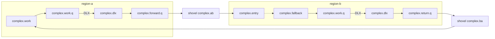

# RabbitMQ 4.3 topology demo

[full-export-definitions.json](full-export-definitions.json) is a complete,
unmodified `GET /api/definitions` response from a disposable RabbitMQ **4.3.6**
broker. It was captured once on 2026-10-28 after provisioning the scenarios below
and waiting for all 13 shovels to run. It can be imported for demonstrations.
Tests reuse this file; they never regenerate or overwrite it.

The demo contains **10 virtual hosts, 54 exchanges, 46 queues, 55 bindings,
two regular policies, and 13 shovels**. Every designed route and elementary
cycle stays below the 20-hop limit. The longest cycle has 11 hops; the longest
healthy route has seven. A shovel contributes two graph edges: resource to
shovel and shovel to resource. Repeated traversal of a cycle is unbounded;
the hop limit describes one elementary cycle or a complete acyclic route.

The full export also retains the broker's default `/` vhost, system logging
exchange, and disposable `guest` account with its broker-generated password
hash. Shovel URIs contain no explicit credentials. This is intentionally a
complete demo export from an isolated broker, not a production capture.

## Files and evidence

| File | Purpose |
| --- | --- |
| [full-export-definitions.json](full-export-definitions.json) | Importable, cluster-wide broker export; original response bytes |
| [queues.json](queues.json) | Complete `GET /api/queues?disable_stats=true` array |
| [exchanges.json](exchanges.json) | Complete `GET /api/exchanges?disable_stats=true` array |
| [provenance.json](provenance.json) | Broker version, Docker image digest, hashes, and designed result counts |

All three responses came from the same quiescent broker window. The queue and
exchange observations preserve broker-selected policy evidence and quorum
membership. Sequential API calls are not an atomic snapshot. This one-node
capture has a replication factor of **one** for its quorum queues; it does not
demonstrate replicated availability across several brokers.

The raw export was also imported into a second fresh 4.3.6 broker. All ten demo
vhosts and thirteen shovels were restored. Runtime tests separately verify the
healthy routing cases against an isolated import.

## Scenario map

All listed vhosts start with `topology-demo.`. Resource names identify the case
inside a vhost; shared names in different vhosts remain distinct identities.

| Vhost / resource prefix | Configured scenario | Expected result |
| --- | --- | --- |
| `routing` / `route.*` | Direct → topic → headers → fanout → classic, quorum, and stream queues | Acyclic; four exchange types; direct fanout targets counted once |
| `routing` / `headers.*` | `all`, `any`, `all-with-x`, and `any-with-x` header bindings | All four modes retained, including parallel bindings |
| `fallback` / `fallback.*` | Primary direct exchange → alternate topic exchange → alternate fanout → parking queue | Acyclic fallback chain; matching primary messages bypass the parking queue |
| `deadletter` / `retry.*`, `work.*`, `poison.*` | TTL queue → work exchange → quorum queue → poison DLX → parking queue | Acyclic; TTL expiry, rejection, and delivery-limit cases reach the expected queues |
| `loops` / `binding.self` | Fanout exchange bound to itself | One structural self-loop; no message-loop candidate |
| `loops` / `binding.a/b/c` | Direct → topic → fanout → direct, with parallel bindings | One three-hop structural cycle; no message-loop candidate |
| `loops` / `alternate.a/b` | Two exchanges configured as each other's alternate | One two-hop structural cycle; no message-loop candidate |
| `loops` / `mixed.a/b` | Alternate-exchange hop and returning exchange binding | One two-hop structural cycle; no message-loop candidate |
| `loops` / `dead.self*` | Queue → DLX → same queue | One two-hop message-loop candidate |
| `loops` / `dead.a/b*` | Two queues with DLX routes through each other's exchange | One four-hop message-loop candidate |
| `loops` / `dead-ae.*` | Queue → DLX → alternate exchange → queue | One three-hop message-loop candidate |
| `region-a/b/c` / `pipeline.*` | Two queue-to-exchange shovels bridge three vhosts | Acyclic seven-hop route; actual delivery at the third vhost |
| `region-a/b` / `shovel2.*` | Two shovels return to the first vhost | One six-hop message-loop candidate |
| `region-a/b/c` / `shovel3.*` | Three shovels form a ring through three vhosts | One nine-hop message-loop candidate |
| `region-a/b` / `complex.*` | DLX routes, an alternate exchange, and two shovels form a ring | One eleven-hop message-loop candidate |
| `region-a/b/c` / `compete.*` | Two shovels consume one source queue and publish to separate destinations | One competing-consumer group, even though the shovels are declared in different vhosts |
| `diagnostics` / `diag.*` | Empty exchanges, orphan queue, missing AE and missing DLX | Two demo black holes, one queue without declared ingress, two dangling edges |
| `diagnostics`, `region-b` / `alias.*` | Running source on `127.0.0.1`, with that alias omitted from audit locality evidence | Unconfirmed source; no invented local source edge |
| `region-a/b`, `diagnostics` / `uncertain.*` | Source failover list names two different vhosts | Source vhost unresolved; retained shovel evidence without choosing an arbitrary source identity |
| `policies` / `policy.*`, `argument.*` | Broker-selected DLX/AE policies and direct argument overrides | Per-key argument precedence; policy routing key retained; vhost default resolves the argument-free quorum queue |
| `control` | Declares most shovels separately from their endpoint vhosts | Declaring vhost does not determine endpoint identity |

The eleven-hop case contains these configured possibilities. Solid arrows are
bindings, the dotted arrow is an alternate exchange, `DLX` arrows require
dead-lettering, and shovel arrows represent consumption and publication.
They do not promise that every message will traverse the cycle.



## Expected analysis

With both observations and no supplied host aliases, the fixture has:

- 10 structural cycles and 6 message-loop candidates, with no truncation;
- 10 cyclic strongly connected components;
- 2 dangling edges, referencing `missing.alternate` and `missing.dlx`;
- 1 competing-shovel group on `region-a`'s `compete.source`;
- 12 shovels with different resolved source/destination vhosts;
- 2 shovels with unconfirmed endpoints, including 1 unresolved source vhost;
- 1 queue without declared ingress, `diagnostics`'s `diag.orphan`.

`diag.blackhole` and `diag.empty-fanout` are the two demo black-hole exchanges.
The full cluster export additionally contains `/`'s unbound `amq.rabbitmq.log`,
which the auditor correctly reports too. The implicit default exchange is
excluded. These findings describe captured routes, not guaranteed delivery or
message loss. Shovels consume from their source queue; two consumers of an
ordinary queue share work rather than each receiving every message.

Supplying `in_cluster_amqp_hosts={"127.0.0.1"}` confirms `alias.unconfirmed` and
adds its source edge. The failover source remains unresolved because its two
URIs name different vhosts. Both cases are running shovels: locality findings
are properties of the supplied evidence, not runtime health checks.

The independent expected paths and feature assertions live in
[tests/shared/complex_topology.py](../../../shared/complex_topology.py).

Fanout capacity metrics retain the same direct targets: `route.fanout` has
3 durable queues, including 1 quorum queue with 1 captured member. Parallel
bindings contribute one queue target. Empty fanout groups report zero targets
and zero quorum members; captured targets in this demo have known durability,
types, and quorum membership. Focused tests cover incomplete evidence and
non-durable queues without rewriting the demo capture.

Effective DLX coverage reports 34 queues without a DLX, 10 with a possible
queue destination, 1 missing DLX exchange (`diag.missing-dlx`), and 1 stream
where dead-lettering is not applicable. The terminal `poison.plq` remains in
the `no_dlx` results. Policy-derived DLXs and argument overrides are included;
later shovel hops do not become destinations of the initial DLX publication.

Routing-aware exchange coverage also reports binding and alternate cycles
without queue destinations, policy-selected fallbacks, and uncertain header
predicates. With key `healthy`, `diag.entry` reaches `diag.sink`; with
`unmatched`, it has no queue destination even though its bindings are present.
These are contextual findings alongside the existing degree-only black holes.

The queue inventory contains 46 queues: 42 classic, 3 quorum, and 1 stream.
The `policies` vhost defaults to quorum but contains 6 classic queues and 1
quorum queue. The `control` vhost has no queues and remains in the inventory;
the full capture also retains `/`, which has no queues. These expectations are
checked from both saved captures and freshly imported demo resources.

## Use for a demo

Import the complete definitions JSON into a **disposable RabbitMQ 4.3 broker**
with `rabbitmq_shovel` and `rabbitmq_shovel_management` enabled. For example,
from the repository root, replace `YOUR_DEMO_CONTAINER` with its container name:

```bash
docker cp tests/integration/rmq-4.3/complex-topology/full-export-definitions.json YOUR_DEMO_CONTAINER:/tmp/topology-demo.json
docker exec YOUR_DEMO_CONTAINER rabbitmqctl import_definitions /tmp/topology-demo.json
```

The command starts an asynchronous import; wait for the demo vhosts, queues,
and all 13 shovels to appear. Credential-free shovel URIs use the broker's
default AMQP credentials, so the imported disposable guest account must be
allowed to access these vhosts locally. The captured export includes its
permissions. All URI endpoints are local to that broker; no remote service is
required. The full import includes the disposable user record.

The loop scenarios are intentionally empty. Live tests publish only to healthy
paths and the bounded poison-message case. For manual delivery demonstrations,
use `routing`, `fallback`, `deadletter`, `pipeline.*`, or `compete.*`.

To audit the saved files from the repository root:

```python
from pathlib import Path

from rabbitmq_management_sdk import ClusterAuditor

capture = Path("tests/integration/rmq-4.3/complex-topology")
auditor = ClusterAuditor.from_files(
    capture / "full-export-definitions.json",
    queues_path=capture / "queues.json",
    exchanges_path=capture / "exchanges.json",
)
report = auditor.audit()
assert len(report.structural_cycles.cycles) == 10
assert len(report.message_loop_candidates.cycles) == 6
assert len(report.competing_shovel_consumers) == 1
```

After importing on a different broker, capture fresh complete queue and
exchange observations when auditing that broker. The saved observations
describe the original capture's node membership and policy selection.

## Run the tests

```bash
# Offline: reuse the saved artifact without a broker.
uv run --python 3.12 pytest tests/integration/test_complex_topology_capture.py

# All live tests, including this fixture, on the disposable 4.3 Compose broker.
UV_PYTHON=3.12 just test-live-rmq43
```

[The live tests](../../../live/test_complex_topology.py) import only the demo's
resource sections into ten uniquely named vhosts. They add the configured test
credentials to shovel URIs in memory, grant permissions only on those vhosts,
and preserve the connected broker's users and cluster parameters. Cleanup is
registered before import, so partial setup failures and assertion failures
still delete the temporary vhosts. No fixture or report files are written.
The tests take one fresh in-memory definitions/resource snapshot for analysis.

They verify the same directed cycles, SCCs, capped searches, policy routes,
degree findings, shovel advisories, and fanout targets as the offline tests.
Delivery checks cover exchange matching, alternate routing, TTL and rejection
dead lettering, quorum poison-message delivery limits, policy overrides,
cross-vhost shovels, and competing consumers. They do not measure throughput or
replication across multiple brokers.

## Broker export boundaries

RabbitMQ 4.3.6's
[definitions exporter](https://github.com/rabbitmq/rabbitmq-server/blob/v4.3.6/deps/rabbit/src/rabbit_definitions.erl)
omits internal exchange declarations and global parameters whose names start
with `internal`, including `internal_cluster_id`. Both HTTP and CLI exports
were checked. The final demo uses no custom internal exchanges, so its full
export imports without reconstructing missing declarations. Positive
unreachable-internal-exchange coverage remains in the existing unit tests;
this captured fixture asserts the empty result for that finding. The SDK
retains `cluster_id=None` for this export rather than inventing an identity.

The final artifact does not contain operator policies; they do not supply
DLX/AE routing evidence here. Regular policy selection comes from the supplied
observations. See the broker's versioned guides for
[alternate exchanges](https://www.rabbitmq.com/docs/4.3/ae),
[dynamic shovels](https://www.rabbitmq.com/docs/4.3/shovel-dynamic), and
[quorum poison-message handling](https://www.rabbitmq.com/docs/4.3/quorum-queues#poison-message-handling).
